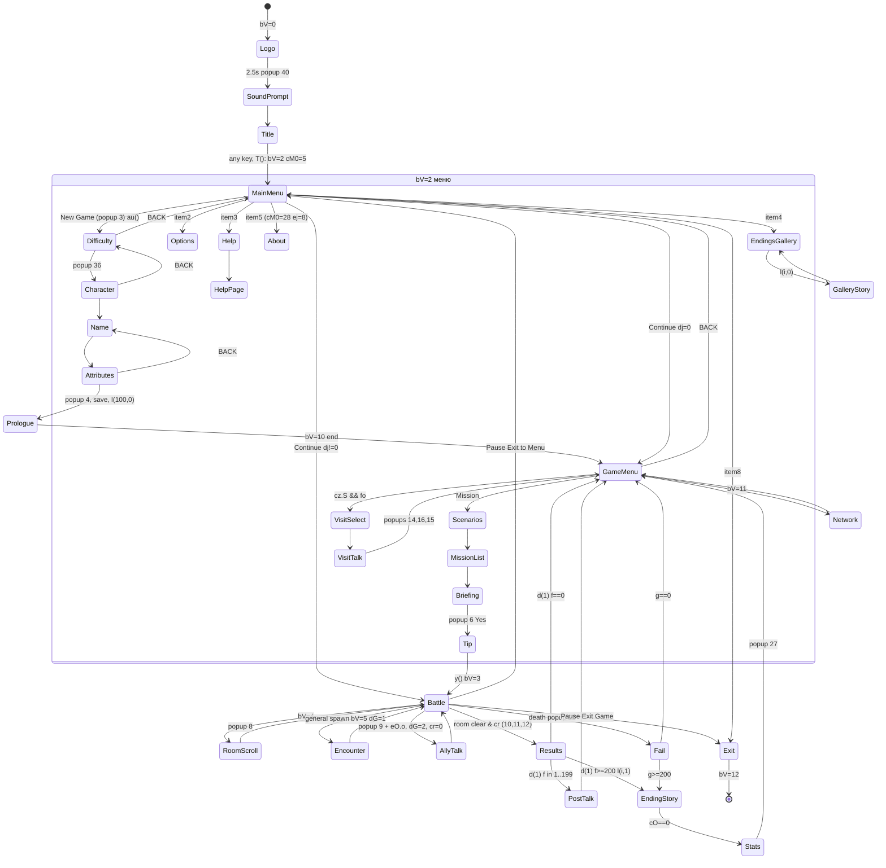

# 04 — Кампанія, сюжет і глобальна машина станів (Path of a Warrior, J2ME → Godot 4.5)

> **Примітка (30.10.2026).** Звіт писався, коли ціллю був Godot.
> - Технічна частина (формати, формули, посилання на рядки Java) чинна.
> - Розділ «План порту на Godot» у кінці застарів. Актуальний план — `docs/ROADMAP.md` і `docs/plans/`.
> - Розбір робився на копії без PNG, тому звіт пише «PNG немає». У вашій папці вони є.
> - Виправлення до старих документів — `ERRATA.md`.

Що я реально читав:
- **Повністю:** `l.java` (1–893), `ae.java`, `af.java`, `Main.java`, `k.java`, `al.java`, `d.java`, `j.java`, `at.java`, `an.java`, `am.java`.
- **По ділянках:**
  - `ag.java` — 1–3579 (з пропусками; конкретні рядки цитую нижче);
  - `e.java` — 1–1527, 1694–1802, 2137–2400, 3208–3603;
  - `c.java` — 920–1125, 1300–1660, 1740–1770;
  - `ar.java` — 1–250, 720–742, 1310–1345, 1795–1932;
  - `as.java` — 180–205, 1300–1315.

Дані декодовано через `python3 -I` (§2.13). Позначка **[guess]** означає висновок, не підтверджений кодом напряму.

## 1. Глобальна машина станів

### 1.1 `bV` — верхній рівень

| bV | Що це | Код | Вхід | Вихід |
|---|---|---|---|---|
| 0 | Boot: `logo1` 2,5 с → попап 40 «sound?» → титул (`title_1..4`, `gamevil`, блимаюче `press`) | `af.a()/b()` (af 16–67), `ag.E()` 1154, `ag.S()` 1985 | `ag.s()` 645 | будь-яка клавіша → `ag.T()` 2004–2124 → bV 2, cM0 = 5 |
| 1 | не використовується (лише перевірка в l 77) | | | |
| 2 | Усі меню; екран = `cM[0]` | малювання `e.a(int)` 10–205; ввід `e.a()` 207–302; `ag.P()` 1899 | `T()`, `M()` 1637, `an()` 2669, `l.b()` 179/310, `e.i()` 1296, as 1971, ar 185 | `y()` → 3, `l()` → 10, `as.h()` → 11, `as()` → 12 |
| 3 | Бій | `ar.a()` 6–23 | `y()` 883, `e.i()` 1287/1305, `ar.k()` 1923 | 4, 5, 2, 12 |
| 4 | Скрол камери між кімнатами 7×7 | `ar.k()` 1892–1932 | `ar.aC()` 1846 | 3 + попап 8 «Stage N» (`do++`) |
| 5 | Діалог у бою (таймер на паузі) | `bb.h()`, `bb.i()` (e 1266–1368) | `c.b()` 993 (`dG=1`), `c.g()` 1611 (`dG=2`) | `dG==1` → 3; `dG==2 && cr` → 2 (Game Menu); `dG==2 && !cr` → 3 |
| 6–9 | не використовуються (`L()` повертає) | | | |
| 10 | Пролог або одна з 24 кінцівок | `L()` 1547–1567, `M()` 1612–1692, `N()` 1698–1737, `c.c(int)` 1393–1514 | `ag.l(i,p)` 3488–3528 | `cM0 = cO` (0 або 25), bV 2 |
| 11 | Gamevil Live (мережа) | `as` | Game Menu, пункт 2 → `be.g()` | as 1971 → 2 |
| 12 | «outro» 3 с → `destroyApp` | `at()` 3011, P 1889 | `as()` 3003 (попапи 28/1/18) | вихід |

Допоміжні змінні:
- `bW` — bV під накладеними меню, коли Help/Options відкрито з бою (`bW = 3`).
- `bX` — bV попереднього кадру; при зміні стану клавіші скидаються (ag 726–755).
- `ck` — режим перемальовки: 1 = повна, 2 = анімація каруселі.

Клавіші: `-5/53` OK, `-6` ліва софт-клавіша (SKIP/OK), `-7` права (BACK), `-1..-4` або 2/8/4/6 — напрямки. Підписи софт-клавіш — `ae.t[]`, малює `ag.h()` 3045.

### 1.2 `cM[0]` при `bV==2`

Службові поля:
- `cM[1]` — вибраний пункт; `cM[2]` — вікно прокрутки на 5 рядків (`ag.I()` 1203); `cN` — кількість пунктів.
- `cO` — екран, з якого прийшли (`e.c()` 1120); `cP/cQ` — пам'ять позиції курсора кожного екрана (`ap()` 2728).

Таблиці:
- `ae.aW[cM0][cM1%7]` — куди веде OK (−1 = спецлогіка в `e.b()` 688–1000).
- `ae.u` — куди веде BACK (100 = повернутися в `cO`, −1 = спецлогіка в `e.aF()` 1002–1109).
- `ae.v` — `cN` за замовчуванням.
- `ae.A` — музика: 0 = `snd0` (титул), 1 = `snd1` (бій), 2 = `snd2` (меню), −1 = не змінювати.
- Заголовок екрана = `uimenu.scr[cM0]`.

| cM0 | Заголовок | Екран | Ввід | OK | BACK (u) | v | A |
|---|---|---|---|---|---|---|---|
| 0 | Game Menu | Карусель `e.bf()` 3283; **5 досяжних пунктів**: Mission, Blacksmith, Gamevil Live, Visiting, Management | ↑↓ | 0→1; 1→12; 2→bV 11; 3→19 (якщо `cz.S && fo`, інакше попап 35); 4→13. `aW[0][5]=10` (ETC) недосяжний | Main Menu (e 1079–1089) | 6 | 2 |
| 1 | Missions | Список сценаріїв для `cq` (`ag.C()` 1043); заблоковані за `dw` — сірі | ↑↓ (←→ лише чит, змінює `cq`) | → 2: `dk=cM1`, `bi()` (e 823–833) | 0 | `dr` | 2 |
| 2 | Missions | Місії сценарію = імена правителів `dA` (`bi()` 3569) | ↑↓ | → 3: `dm=cM1`, `D()` | 1 | `dv[dk]` | 2 |
| 3 | Briefing | `dl`+`dn` і `brief.scr[du+dm]` по 6 рядків (`aH()` 1229) | ←→ сторінки | OK/−6 → попап 6 → Yes: `cM0=4`, `dG=0`, `dH++`, `am()` (l 109–114) | 2 | – | 2 |
| 4 | Tip | Діалог правителя (`event1`), портрети: правитель `dB[dm]` + герой | OK прискорює, −6 пропуск | кінець → `y()` → bV 3 (e 1308) | – | – | **1** |
| 5 | MainMenu | Рядок `M_text` (21 px; рядок 9 = сірий Continue) (`aJ()` 1370) | ←→ 0..8 | 0 Continue; 1 New Game (попап 3 → `au()`); 2→9 Options; 3→27 Help; 4→25 Endings; 5→28 About (`ej=8`); 6/7 попапи 41/42; 8 попап 28 | – | 8 (T: 10) | 0 |
| 6 | CHARACTER | 3 портрети `ju_*` (`aK()` 1385); значення в `cz.aB` | ←→ | → 7 | 29 | – | 0 |
| 7 | NAME | Сітка A–Z+OK (`ag.f()` 1794), буфер `at`: до 8 символів, перша літера велика | стрілки, −7 видаляє (на порожньому → 6) | «OK» при непорожньому імені → 8, `aw()` | 6 | – | 0 |
| 8 | ATTRIBUTES | Рядки HP+5, MP+3, ATK+1, DEF+1 (`O()` 1429) | ↑↓ | витрачає `cz.J`; при 0 → попап 4: Yes = `ax()`, `ay()`, `ar()`, `cM0=0`, `aA()`, **`l(100,0)` Пролог**; No = `aw()` | 7 | 4 | 0 |
| 9 | Options | Volume, Speed (`j()` 1471; Sound і Diff не малюються) | ←→ | `ag.y(int)` 2474 | 5 | 3 | −1 (стоп) |
| 10 | Etc / PAUSE | Меню: «Options\|Help». У бою з `dE=fZ`: «Resume\|Options\|Save\|Assign Items\|Help\|Exit to Menu\|Exit Game» | ↑↓ | 0→9, 1→27, (2 → попап 5) | 0 | 2 | 2 |
| 11 | Save | недосяжний; збереження автоматичні | | | 10 | | −1 |
| 12 / 13 | Blacksmith / Management | | | 21–24 / 14–18 | 0 | 4/5 | 2 |
| 14–18 | Attributes / Skills / Gear / Inventory / Assign | поза скоупом | | | 13 + автосейв `ar()` | | 2 |
| 19 | Select (Visiting) | «Name \| Points», 4 на сторінку (`aN()` 1694) | ↑↓ ±1, ←→ ±4 | → 20: `bg()` 3366 | 100 (→ 0) | `fo`/44 | 2 |
| 20 | Visiting | Розмова (`aO()` 1750) → попапи 14/16/15 → `cM0=0` | OK | | – | | (не перемикається) |
| 21–24 | Buy / Sell / Enchant / Combine | поза скоупом | | | 12 | | 2 |
| 25 | Endings | 24 назви (`text.scr` 38..61), 5 на сторінку, сірі якщо біт `ed`=0 (e 1185–1203) | ↑↓, ←→ ±5 | зібрана → `l(i,0)`; незібрана → «You must first complete the missions needed to view this ending.» (e 988–995) | 5 | 25 | 0 |
| 27 / 28 | Help / сторінка теми | Теми з `uimenu[38]` (8 досяжних); текст `help.scr[ae.z[ej]+cM1]` (`l()` 2311) | ↑↓ / ←→ | → 28 | 5 / `cO` | 8 | −1 |
| 29 | DIFFICULTY | Hard/Normal + опис `ae.aY` (`aU()` 2374); `ep=cM1`, за замовч. 1 = Normal | ↑↓ | попап 36 → 6 (l 166–169) | 5 | 2 | – |

**Попапи `cS`.** Хто що робить у `l.java`:
- `e(n)` (600–887) — каталог попапів;
- `d(n)` (506–598) — текст з `gamestr[n+15]`; перша цифра рядка = тип попапу, `\` = перенос;
- `b()` (62–324) — ввід і наслідки після закриття.

Типи попапів: 1 = повідомлення, 2 = Yes/No, 3 = вибір із 4, 4 = результати, 10 = кнопка OK. Таймер: 20 кадрів = автозакриття, 200 = чекати клавішу. Ключові для кампанії:

| id | Текст | Наслідок |
|---|---|---|
| 3 | Starting a new game will cause your saved game to be deleted. | Yes → `au()` → cM0 29 |
| 4 | Character settings are complete. Continue? | Yes → сейв + Пролог; No → скидання статів |
| 5 | Exit Game and go to main menu? (за замовч. No) | з меню → cM0 5; з паузи бою → `al(); w(2)`, bV 2, cM0 5 |
| 6 | `<ціль>` / `Lv<cz.l+j> / Gold:<h·150·(Hard?2:1)>` / Accept? | Yes → cM0 4 |
| 7 | Can't Save! it Needs all enemy dead. | |
| 8 / 9 | `<сценарій>/<правитель>/Stage N[ Complete.]` | 9 → якщо в кімнаті є `eO[eP].o` → діалог із союзником, інакше `co=1` (показати виходи) |
| 10→11→(12) | Mission Success + Gold → Total Exp → Time Exp (якщо `dX<i`) | `c.h()`, потім `bd.d(1)` |
| 14 | What do you want to talk about? Sword/Books/Tactics/People | тема візиту |
| 15 | You visited X. Friendship increased by 5 / Friendship:100% + нагорода | → Game Menu |
| 16 | You discussed `<тема>` with X. | `cz.S=0`, `o()`, +5, `ar()` → 15 |
| 22 | `<сценарій>/<правитель>/Mission fail!` (+ «Lost!! `<предмет>`») | `g>200` → `bd.d(0)`, інакше Game Menu |
| 27 | `<предмет>` received! / Hidden Mission! `<сценарій>` | після кінцівки |
| 28 | Exit Game? | → bV 12 |
| 35 | Generals can not be visited at this time… | |
| 36 | Difficulty will not change after starting. Continue? | → CHARACTER |
| 40 | Would you like sound enabled? | boot: `df`, `dg=75` |

### 1.3 Підстани бою (контракт для бойової частини)

- **`cR.a`** (стан у bV 3): 0 гра, 1 пауза (`ar.o()` 95–247), 2 Assign items, 3 Options, 4 Help.
- **`co`/`cn`** — відкладена подія з затримкою `cn` кадрів (`ar.aC()` 1841–1878):
  - 1 = кімнату зачищено → показати стрілки виходів / почати скрол;
  - 2 → попап 8;
  - 3 → попап 9;
  - 4 → попап 10.
- **`dG`** — тип діалогу; файл `v(57+dG)`:
  - 0 = Tip (`event1`);
  - 1 = зустріч з генералом (`event2`);
  - 2 = розмова після перемоги (`event3`).
- **`cr = 1`**, коли з'являється цільовий генерал місії (c 985–986).
- **Save у паузі** працює лише в зачищеній кімнаті (`ez==0 && cr==0 && eD[0]==0`, ar 202–207) і пише `dj = 1` (продовження з середини місії).

### 1.4 Потоки

**Boot.**
1. `s()` → bV 0 → `af`: лого 2,5 с → попап 40 «sound?» → титул.
2. Будь-яка клавіша → `bb.g()` → `T()`.
3. `T()`: `w(0)` (рамка меню), `cM0 = 5`, **`U()` — сейв завантажується вже на старті**, bV 2.
4. Якщо сейва немає — курсор на New Game.

**Нова гра.**
1. Main Menu, пункт 1 → (попап 3, якщо сейв існує) → `au()` 3213.
2. `av()` 3222–3273 скидає все:
   - `dw = 35113052110447`, `dx = ed = cq = fo = 0`, `dy = 0`;
   - `cz.l = 1`; базові стати `aw()` 3275: ATK 5, DEF 4, HP 30, MP 10, вільних очок 5;
   - скіли `W[0] = W[5] = 1`; стартовий предмет 116 одягнутий.
3. DIFFICULTY (попап 36) → CHARACTER → NAME → ATTRIBUTES (попап 4).
4. Сейв → `aA()` → Пролог → Game Menu.

**Місія.**
1. Game Menu → Missions (cM0 1) → Missions (2) → Briefing (3) → попап 6 → Tip (4).
2. `y()` 872–967: позиція гравця `(b·27+12, c·27+20)`, `do = 1`, `dY = 0`; завантажується карта `ds[dk]` з таблицею кімнат місії `dm` (c 1089) → bV 3.
3. **Перемога:** попапи 10/11/12 → `bd.d(1)` (§2.8) → розмова з генералом `f` (bV 5) або кінцівка (bV 10) → статистика → попап 27 → Game Menu.
4. **Поразка:** смерть героя (c 1755–1763) → `fq` −5 → попап 22 → `dj = 0`, сейв → кінцівка (якщо `g ≥ 200`) або Game Menu.

**Visiting.** Game Menu → 19 → 20: 3 репліки привітання → попап 14 (тема) → 2 репліки → попап 16 → попап 15 → Game Menu.

**Endings (галерея).** Main Menu → 25 → `l(i,0)` → історія без статистики й нагород → назад у 25.

**Continue** (e 838–868):
1. `U()`, `F()`, `cM0 = 0`.
2. Якщо `dj != 0`: `C(); bi(); D(); y()` — одразу назад у бій.

### 1.5 Діаграма станів



### 1.6 Артефакти декомпілятора (важливо для порту)

1. **`++arr[i]` / `--arr[i]`.** JD-Core друкує це як `cM[1]=cM[1]+1; if (cM[1]+1 >= cN)`. Якщо портувати буквально, перший або останній пункт будь-якого списку стане недосяжним. Читати слід як «інкремент, потім порівняння нового значення».
   - Доказ: у `bf()` (e 3349, 3351) підписи попереднього/наступного пункту явно циклюють 0↔4, тобто в Game Menu 5 пунктів.
2. **Ланцюгове присвоєння.** У `ag.a(byte[],int)` (рядки 1109–1110) два виклики `a(…,')')` поспіль — це насправді `arrayOfInt2[1] = arrayOfInt3[1] = a(…)`.
   - Буквальний варіант кидав би виключення в `arraycopy` (від'ємна довжина) на будь-якому шаблоні бріфінгу з ≥2 підстановками. Перевірено емуляцією.

## 2. Формати даних і декодована кампанія

### 2.1 Контейнер `.scr` (`al`)

- Структура: `u16 LE count`, потім таблиця зміщень `u16 LE` (запис k = `[off[k], off[k+1])`), потім UTF-8 рядки без префікса довжини.
- Порядок байтів **little-endian**. У `JAVA_REFERENCE.md` §1 написано «big-endian» — це помилка в документі; код `decode_scr.py` насправді читає LE.
- `decode_scr.py` зупиняється на першому порожньому записі: у `uimenu.scr` 60 записів, а скрипт видав лише 0..27.

Карта `edat.scr` (індекс → файл):

| Індекс | Файл | Індекс | Файл |
|---|---|---|---|
| 0–44 | `1.arr`…`45.arr` (кімнати сценаріїв) | 56 | brief |
| 46 | general | 57–59 | event1–3 |
| 48 | mission | 61 | help |
| 50 | sideinfo | 62 | visit |
| 52 | visitgen | 63 | opening |
| 54 | text | 64–67 | ending0–3 |
| 55 | ruler | 69 / 70 | uimenu / gamestr |

`visitpro.arr` (53) і `help_m.scr` (60) у коді не завантажуються.

### 2.2 `mission.arr`: 45 сценаріїв

- Розмір: 1758 = 10 + 46×38.
- Запис `L` починається з `E = 38·L + 10`:

| Байти | Поле |
|---|---|
| 0–29 | назва сценарію |
| 30–35 | id сценаріїв, які показує екран «Missions», коли `cq == L` (`ds[b] = arr[38·cq+40+b]`) |
| 36 | `du` — перша місія в sideinfo/brief |
| 37 | `dv` — кількість місій |

- `ag.C()` 1043–1062 збирає з цього список для поточного `cq`.
- Початкове `dw` (ag 3225) закриває сценарії 5, 8, 9, 16, 25, 26, 28, 29, 32, 37. Це ті самі нулі, що в масці «Hidden Mission» `0x1FEF64FF7E6F` (c 1452); у них разом 18 місій.

| id | Назва | dv | du | Кімнат | next-list | Прихований |
|---|---|---|---|---|---|---|
| 0 | *(None — список для cq=0)* | – | – | – | [1] | – |
| 1 | The Rise | 4 | 0 | 3 | [2] | |
| 2 | The Yellow | 4 | 4 | 3 | [3] | |
| 3 | Hellgate | 5 | 8 | 9 | [4] | |
| 4 | Blue Mountain | 5 | 13 | 12 | [5, 6] | |
| 5 | Royal Seal | 2 | 18 | 8 | [8, 9, 10] | **так** |
| 6 | Brown Soil | 2 | 20 | 8 | [7] | |
| 7 | The End | 2 | 22 | 8 | [10] | |
| 8 | Assassin | 2 | 24 | 9 | [11, 12] | **так** |
| 9 | Brotherhood | 2 | 26 | 12 | [12] | **так** |
| 10 | Honor | 2 | 28 | 9 | [11, 12] | |
| 11 | Strongest Man | 3 | 30 | 7 | [13] | |
| 12 | Maniac | 5 | 33 | 12 | [11, 13] | |
| 13 | Red Castle | 2 | 38 | 9 | [14] | |
| 14 | White Horse | 2 | 40 | 6 | [15, 16] | |
| 15 | The Power | 2 | 42 | 8 | [17] | |
| 16 | Lionheart | 1 | 44 | 10 | [15] | **так** |
| 17 | South Castle | 2 | 45 | 6 | [18, 20] | |
| 18 | Fall of Honor | 2 | 47 | 6 | [19] | |
| 19 | Hunt Down | 2 | 49 | 15 | [20] | |
| 20 | New Chance | 2 | 51 | 12 | [21, 22] | |
| 21 | Crash | 2 | 53 | 15 | [22, 23] | |
| 22 | Vengeance | 2 | 55 | 8 | [24] | |
| 23 | Out-numbered | 2 | 57 | 6 | [24, 25] | |
| 24 | Exodus | 2 | 59 | 6 | [27] | |
| 25 | Chaos | 1 | 61 | 15 | [26, 24] | **так** |
| 26 | A Wish | 2 | 62 | 9 | [28, 24] | **так** |
| 27 | Showdown | 2 | 64 | 16 | [30, 34, 35, 36, 37, 29] | |
| 28 | Sebastian | 2 | 66 | 9 | [27] | **так** |
| 29 | Chasing | 2 | 68 | 5 | [35] | **так** |
| 30 | Soul Valley | 2 | 70 | 6 | [31, 43] | |
| 31 | Golden Aaron | 2 | 72 | 20 | [32, 33] | |
| 32 | Stand-Alone | 2 | 74 | 12 | [33, 41, 43] | **так** |
| 33 | Black Plain I | 2 | 76 | 15 | [43] | |
| 34 | White Lake | 2 | 78 | 9 | [38] | |
| 35 | Green Swamp | 2 | 80 | 8 | [39] | |
| 36 | Brown Peak | 2 | 82 | 9 | [40] | |
| 37 | Blue Port | 2 | 84 | 6 | [41] | **так** |
| 38 | Stargate | 2 | 86 | 1 | [39, 42] | |
| 39 | Mainland | 2 | 88 | 12 | [41] | |
| 40 | Left Sword | 2 | 90 | 12 | [41] | |
| 41 | The Bone Plain | 2 | 92 | 3 | [43] | |
| 42 | Black Plain II | 2 | 94 | 20 | [44, 45] | |
| 43 | Wearisome War | 2 | 96 | 10 | [45] | |
| 44 | Lionheart | 2 | 98 | 7 | [45] | |
| 45 | End of a Hero | 2 | 100 | 10 | [] | |

### 2.3 `sideinfo.arr`: 102 місії

- Розмір: 1133 = 11 + 102×11.
- Запис місії `m` сценарію `dk`: зміщення `11·du + 11 + 11·m` (`e.bi()` 3575–3590). Поля класу `an`:

| Байт | Поле | Значення |
|---|---|---|
| 0 | `a` | id правителя: ім'я `dA`, портрет `dB`, лояльність `cz.g[a-1] += 5` при успіху (c 1522) |
| 1, 2 | `b`, `c` | стартова клітинка гравця (`y()` 892–893) |
| 3 | `d` | палітра солдатів `mon1/mon2`: 0 = оригінал, 1..3 = перефарбування PLTE (ag 973–1023) |
| 4 | `e` | **цільовий генерал**; коли він з'являється, `cr = 1` |
| 5 | `f` | при успіху: 0 = нічого; 1..199 = генерал для розмови після бою (+5 дружби); ≥200 = кінцівка `f−200` |
| 6 | `g` | при провалі: 0 = нічого; ≥200 = кінцівка `g−200` (l 301) |
| 7 | `h` | золото = `h·150·(1+(ep^1))` (c 1603) |
| 8–9 | `i` | ліміт часу в секундах. **Java бере `b8&0xFF \| b9&0xFF00` без зсуву** (e 3588) → фактично лише молодший байт |
| 10 | `j` | рівень цілі, показаний у попапі 6 (`cz.l + j`); збігається зі зсувом рівня в кімнаті |

### 2.4 `ruler.arr`: 22 правителі

- Розмір: 333 = 3 + 22×15.
- Запис = 14 байт імені + 1 байт портрета (індекс `imgchar`: 0 = `noface`, N = `jang_N`).

| a | Ім'я | Портрет | Місій | a | Ім'я | Портрет | Місій |
|---|---|---|---|---|---|---|---|
| 1 | Lord Gabriel | 33 | 27 | 12 | Lord Donald | 0 | 1 |
| 2 | Lord Frederick | 34 | 26 | 13 | Lord Ferdinand | 0 | 2 |
| 3 | Lord Vincent | 25 | 5 | 14 | Lord Conrad | 4 | 2 |
| 4 | Lord Edison | 0 | 1 | 15 | Lord Leonard | 32 | 7 |
| 5 | Lord Edgar | 0 | 1 | 16 | Lord Aaron | 7 | 3 |
| 6 | Lord Herbert | 0 | 4 | 17 | Lord Agnes | 36 | 1 |
| 7 | Lord Eugene | 0 | 8 | 18 | Lord Leslie | 0 | 1 |
| 8 | Lord Benjamin | 0 | 2 | 19 | Lord Theodore | 0 | 1 |
| 9 | Lord Anthony | 0 | 2 | 20 | Lord Oswald | 0 | 1 |
| 10 | Lord Charles | 0 | 1 | 21 | Lord Martin | 0 | 1 |
| 11 | Lord Jacob | 31 | 2 | 22 | Lord Daniel | 35 | 3 |

### 2.5 Місія ↔ карта ↔ кімнати

- Карта = сценарій: `bd.a(ds[dk])` читає `N.arr` (c 1089–1116), тайли — з `mdat_QVGA.scr[ds−1]`.
- Структура `N.arr`: 20 байт заголовка + `dv` блоків по `j·19` байт, де `j` = кількість кімнат 7×7. Блок місії `dm` починається з `20 + j·dm·19`. Отже **кожна місія має власних ворогів на спільній карті**.
- Запис кімнати (19 байт):
  - `a[0..3]` — двері;
  - `b` — максимум ворогів одночасно;
  - 6 пар (тип, кількість/зсув рівня): тип 201..203 = солдати, 1..141 = генерал;
  - байт 18 `o` — союзник для розмови після зачистки кімнати.
- Перевірено: в усіх 102 місіях цільовий генерал `e` присутній у таблиці кімнат саме цієї місії.

### 2.6 `brief.scr`: шаблони

- Контейнер той самий, що й у `.scr`. Індекс бріфінгу = `du[dk] + dm` (= глобальний номер місії).
- Розбір — `ag.a(byte[],int)` 1075–1124:
  - `(…)` у звичайному тексті — дужки просто знімаються;
  - запис `"N|v1|v2|…"` бере базовий запис N і замінює кожну `(…)` наступним значенням `vK`;
  - якщо значень менше, ніж дужок, підставляється порожнє (напр. #23 «lead  to victory» — так в оригіналі).
- Перенос рядків — по 190 px (`ag.b(bytes,190,0)` 3100; `|` = примусовий перенос), показ по 6 рядків на сторінку.
- Приклади (#0 / #1 / #85):
  - #0: «"The Rise of Darkness" … Lord Gabriel is one of them. He is from Beryl Mountain… eliminate General Wallace…»
  - #1 (`0|Lord Frederick|He is from Cerise Plains…|Philip|Frederick|Philip`): «…Lord Frederick is one of them. He is from Cerise Plains… rout General Philip…»
  - #85: «Cerulean Port… Even so, defending the port from Lord Gabriel's armies will not be an easy task. Your mission objective is to help Lord Kestrel and defend Cerulean Port.»

### 2.7 Усі 102 місії

Колонки: № (= індекс бріфінгу), сценарій, `m`, правитель (портрет), спавн, палітра, ціль, `j`, `f`, `g`, золото, ліміт часу (LE16 / як читає Java).

| # | Сц. | m | Ruler (portr) | Spawn | Pal | Target e | j | f (успіх) | g (провал) | Gold | Time LE/Java |
|---|---|---|---|---|---|---|---|---|---|---|---|
| 0 | 1 The Rise | 0 | 1 Gabriel (33) | 4,2 | 1 | 1 Wallace | 1 | 5 Reeve | 0 | 3 (450) | 192/192 |
| 1 | 1 The Rise | 1 | 2 Frederick (34) | 4,2 | 1 | 2 Philip | 2 | 4 Kirkland | 0 | 3 (450) | 192/192 |
| 2 | 1 The Rise | 2 | 3 Vincent (25) | 4,2 | 1 | 3 Langley | 3 | 18 Barclay | 0 | 3 (450) | 192/192 |
| 3 | 1 The Rise | 3 | 4 Edison (0) | 4,20 | 3 | 6 Augustine | 15 | 0 | 0 | 6 (900) | 252/252 |
| 4 | 2 The Yellow | 0 | 1 Gabriel | 4,2 | 1 | 7 Drake | 1 | 6 Augustine | 0 | 3 | 192/192 |
| 5 | 2 The Yellow | 1 | 2 Frederick | 4,2 | 1 | 8 Dunstan | 2 | 11 Charlton | 0 | 3 | 192/192 |
| 6 | 2 The Yellow | 2 | 3 Vincent | 4,2 | 1 | 9 Lord Brenda | 3 | 74 Melbourne | 0 | 3 | 192/192 |
| 7 | 2 The Yellow | 3 | 5 Edgar (0) | 4,20 | 3 | 6 Augustine | 30 | **E1** | 0 | 9 (1350) | 252/252 |
| 8 | 3 Hellgate | 0 | 6 Herbert (0) | 20,12 | 3 | 10 Catherine | 2 | 6 Augustine | 0 | 3 | 192/192 |
| 9 | 3 Hellgate | 1 | 7 Eugene (0) | 11,2 | 3 | 10 Catherine | 2 | 27 Cromwell | 0 | 3 | 192/192 |
| 10 | 3 Hellgate | 2 | 2 Frederick | 3,2 | 3 | 10 Catherine | 2 | 11 Charlton | 0 | 3 | 246/246 |
| 11 | 3 Hellgate | 3 | 3 Vincent | 1,9 | 3 | 10 Catherine | 2 | 18 Barclay | 0 | 3 | 192/192 |
| 12 | 3 Hellgate | 4 | 8 Benjamin (0) | 11,20 | 2 | 12 Lord Wesley | 7 | **E2** | 0 | 5 (750) | 312/56 |
| 13 | 4 Blue Mountain | 0 | 6 Herbert | 18,2 | 3 | 141 Geoffrey | 2 | 5 Reeve | 0 | 3 | 300/44 |
| 14 | 4 Blue Mountain | 1 | 7 Eugene | 11,2 | 3 | 141 Geoffrey | 2 | 27 Cromwell | 0 | 3 | 300/44 |
| 15 | 4 Blue Mountain | 2 | 2 Frederick | 4,2 | 3 | 141 Geoffrey | 2 | 58 Sefton | 0 | 3 | 300/44 |
| 16 | 4 Blue Mountain | 3 | 3 Vincent | 3,14 | 3 | 141 Geoffrey | 2 | 18 Barclay | 0 | 3 | 300/44 |
| 17 | 4 Blue Mountain | 4 | 8 Benjamin | 11,26 | 2 | 12 Lord Wesley | 7 | **E3** | 0 | 5 | 366/110 |
| 18 | 5 Royal Seal | 0 | 3 Vincent | 4,3 | 1 | 16 Winfield | 2 | 74 Melbourne | 0 | 3 | 354/98 |
| 19 | 5 Royal Seal | 1 | 9 Anthony (0) | 4,27 | 2 | 12 Lord Wesley | 4 | **E4** | 0 | 5 | 354/98 |
| 20 | 6 Brown Soil | 0 | 6 Herbert | 4,2 | 2 | 14 Beresford | 3 | 15 Kendrick | 0 | 3 | 246/246 |
| 21 | 6 Brown Soil | 1 | 7 Eugene | 3,27 | 1 | 15 Kendrick | 5 | 14 Beresford | 0 | 5 | 246/246 |
| 22 | 7 The End | 0 | 6 Herbert | 4,27 | 2 | 14 Beresford | 5 | **E7** | 0 | 3 | 300/44 |
| 23 | 7 The End | 1 | 7 Eugene | 11,2 | 1 | 15 Kendrick | 3 | 14 Beresford | 0 | 3 | 300/44 |
| 24 | 8 Assassin | 0 | 2 Frederick | 18,19 | 1 | 20 Blanford | 5 | 21 Devlin | 0 | 3 | 630/118 |
| 25 | 8 Assassin | 1 | 10 Charles (0) | 4,2 | 0 | 21 Devlin | 4 | **E5** | 0 | 3 | 300/44 |
| 26 | 9 Brotherhood | 0 | 11 Jacob (31) | 11,27 | 1 | 18 Barclay | 4 | 19 Luke | 0 | 3 | 408/152 |
| 27 | 9 Brotherhood | 1 | 12 Donald (0) | 11,11 | 2 | 19 Luke | 4 | **E8** | 0 | 3 | 408/152 |
| 28 | 10 Honor | 0 | 1 Gabriel | 11,3 | 2 | 17 Colden | 4 | 15 Kendrick | 0 | 3 | 192/192 |
| 29 | 10 Honor | 1 | 13 Ferdinand (0) | 11,19 | 3 | 15 Kendrick | 10 | 0 | 0 | 6 | 252/252 |
| 30 | 11 Strongest Man | 0 | 14 Conrad (4) | 4,25 | 0 | 11 Charlton | 5 | **E6** | 0 | 6 | 174/174 |
| 31 | 11 Strongest Man | 1 | 1 Gabriel | 4,2 | 1 | 13 Lord Aldred | 5 | 6 Augustine | 0 | 3 | 276/20 |
| 32 | 11 Strongest Man | 2 | 2 Frederick | 4,47 | 1 | 13 Lord Aldred | 5 | 4 Kirkland | 0 | 3 | 276/20 |
| 33 | 12 Maniac | 0 | 14 Conrad | 25,3 | 2 | 73 Ellington | 3 | 13 Lord Aldred | 0 | 6 | 312/56 |
| 34 | 12 Maniac | 1 | 1 Gabriel | 25,18 | 2 | 73 Ellington | 3 | 5 Reeve | 0 | 3 | 312/56 |
| 35 | 12 Maniac | 2 | 2 Frederick | 4,3 | 2 | 73 Ellington | 3 | 4 Kirkland | 0 | 3 | 366/110 |
| 36 | 12 Maniac | 3 | 11 Jacob | 4,20 | 2 | 73 Ellington | 3 | 18 Barclay | 0 | 3 | 366/110 |
| 37 | 12 Maniac | 4 | 13 Ferdinand | 18,11 | 0 | 4 Kirkland | 5 | **E9** | 0 | 10 (1500) | 720/208 |
| 38 | 13 Red Castle | 0 | 2 Frederick | 4,3 | 3 | 6 Augustine | 5 | 26 Clarissa | 0 | 3 | 246/246 |
| 39 | 13 Red Castle | 1 | 1 Gabriel | 18,19 | 0 | 11 Charlton | 5 | 6 Augustine | 0 | 6 | 720/208 |
| 40 | 14 White Horse | 0 | 7 Eugene | 4,40 | 0 | 6 Augustine | 5 | 27 Cromwell | 0 | 3 | 384/128 |
| 41 | 14 White Horse | 1 | 2 Frederick | 4,3 | 2 | 14 Beresford | 7 | 26 Clarissa | 0 | 6 | 384/128 |
| 42 | 15 The Power | 0 | 7 Eugene | 26,11 | 0 | 31 Ingram | 6 | **E11** | 0 | 6 | 390/134 |
| 43 | 15 The Power | 1 | 2 Frederick | 4,3 | 2 | 29 Houghton | 5 | 6 Augustine | 0 | 3 | 360/104 |
| 44 | 16 Lionheart | 0 | 1 Gabriel | 4,2 | 0 | 4 Kirkland | 8 | 6 Augustine | **E10** | 3 | 720/208 |
| 45 | 17 South Castle | 0 | 1 Gabriel | 4,41 | 0 | 31 Ingram | 8 | 5 Reeve | 0 | 3 | 444/188 |
| 46 | 17 South Castle | 1 | 2 Frederick | 4,2 | 3 | 6 Augustine | 8 | **E12** | 0 | 3 | 444/188 |
| 47 | 18 Fall of Honor | 0 | 7 Eugene | 4,3 | 0 | 4 Kirkland | 10 | **E13** | 0 | 6 | 366/110 |
| 48 | 18 Fall of Honor | 1 | 2 Frederick | 17,13 | 2 | 45 Edmar | 10 | 29 Houghton | 0 | 3 | 366/110 |
| 49 | 19 Hunt Down | 0 | 7 Eugene | 11,4 | 0 | 25 Tristan | 15 | **E14** | 0 | 6 | 390/134 |
| 50 | 19 Hunt Down | 1 | 2 Frederick | 11,33 | 2 | 48 Luke | 8 | 31 Ingram | 0 | 3 | 360/104 |
| 51 | 20 New Chance | 0 | 1 Gabriel | 11,3 | 0 | 50 Blackwell | 10 | 15 Kendrick | 0 | 3 | 384/128 |
| 52 | 20 New Chance | 1 | 2 Frederick | 11,26 | 3 | 15 Kendrick | 10 | 58 Sefton | 0 | 6 | 414/158 |
| 53 | 21 Crash | 0 | 1 Gabriel | 11,34 | 0 | 58 Sefton | 10 | 5 Reeve | 0 | 3 | 498/242 |
| 54 | 21 Crash | 1 | 2 Frederick | 11,3 | 3 | 6 Augustine | 15 | 58 Sefton | 0 | 3 | 468/212 |
| 55 | 22 Vengeance | 0 | 15 Leonard (32) | 25,13 | 1 | 54 Escott | 8 | 56 Blake | 0 | 3 | 444/188 |
| 56 | 22 Vengeance | 1 | 9 Anthony | 4,3 | 2 | 74 Melbourne | 11 | **E17** | 0 | 6 | 720/208 |
| 57 | 23 Out-numbered | 0 | 1 Gabriel | 4,41 | 0 | 4 Kirkland | 10 | 6 Augustine | 0 | 5 | 474/218 |
| 58 | 23 Out-numbered | 1 | 2 Frederick | 4,2 | 3 | 6 Augustine | 15 | **E15** | 0 | 6 | 414/158 |
| 59 | 24 Exodus | 0 | 1 Gabriel | 4,41 | 0 | 11 Charlton | 10 | 5 Reeve | 0 | 3 | 1020/252 |
| 60 | 24 Exodus | 1 | 2 Frederick | 4,3 | 3 | 6 Augustine | 30 | 11 Charlton | 0 | 8 (1200) | 522/10 |
| 61 | 25 Chaos | 0 | 1 Gabriel | 11,2 | 0 | 4 Kirkland | 10 | 15 Kendrick | 0 | 10 | 840/72 |
| 62 | 26 A Wish | 0 | 1 Gabriel | 11,10 | 0 | 11 Charlton | 10 | 15 Kendrick | 0 | 3 | 1320/40 |
| 63 | 26 A Wish | 1 | 2 Frederick | 19,4 | 3 | 6 Augustine | 30 | 4 Kirkland | 0 | 3 | 1170/146 |
| 64 | 27 Showdown | 0 | 15 Leonard | 25,12 | 0 | 31 Ingram | 10 | 19 Luke | 0 | 3 | 1512/232 |
| 65 | 27 Showdown | 1 | 2 Frederick | 25,17 | 2 | 19 Luke | 60 | 87 Gregory | 0 | 8 | 2280/232 |
| 66 | 28 Sebastian | 0 | 15 Leonard | 19,4 | 3 | 15 Kendrick | 50 | 55 Jonathan | 0 | 10 | 1140/116 |
| 67 | 28 Sebastian | 1 | 1 Gabriel | 11,10 | 2 | 71 Osric | 10 | 40 Bellamy | 0 | 3 | 1230/206 |
| 68 | 29 Chasing | 0 | 1 Gabriel | 4,34 | 0 | 11 Charlton | 11 | 88 Maxwell | 0 | 3 | 540/28 |
| 69 | 29 Chasing | 1 | 2 Frederick | 4,2 | 3 | 6 Augustine | 30 | 25 Tristan | **E16** | 8 | 990/222 |
| 70 | 30 Soul Valley | 0 | 15 Leonard | 4,2 | 0 | 58 Sefton | 11 | 74 Melbourne | 0 | 3 | 840/72 |
| 71 | 30 Soul Valley | 1 | 2 Frederick | 4,39 | 2 | 57 Cresswell | 50 | 58 Sefton | 0 | 8 | 1560/24 |
| 72 | 31 Golden Aaron | 0 | 16 Aaron (7) | 18,27 | 0 | 26 Clarissa | 15 | 101 Braxton | 0 | 3 | 600/88 |
| 73 | 31 Golden Aaron | 1 | 2 Frederick | 18,2 | 1 | 102 Lord Drake | 30 | 26 Clarissa | 0 | 6 | 630/118 |
| 74 | 32 Stand-Alone | 0 | 16 Aaron | 3,11 | 0 | 31 Ingram | 12 | 102 Lord Drake | 0 | 3 | 648/136 |
| 75 | 32 Stand-Alone | 1 | 2 Frederick | 26,11 | 1 | 102 Lord Drake | 30 | 31 Ingram | 0 | 3 | 378/122 |
| 76 | 33 Black Plain I | 0 | 17 Agnes (36) | 11,34 | 0 | 31 Ingram | 40 | **E21** | 0 | 8 | 1200/176 |
| 77 | 33 Black Plain I | 1 | 2 Frederick | 11,2 | 1 | 101 Braxton | 12 | 26 Clarissa | 0 | 3 | 570/58 |
| 78 | 34 White Lake | 0 | 1 Gabriel | 3,4 | 1 | 106 Preston | 10 | 15 Kendrick | 0 | 3 | 1080/56 |
| 79 | 34 White Lake | 1 | 18 Leslie (0) | 19,18 | 3 | 15 Kendrick | 40 | **E18** | 0 | 6 | 900/132 |
| 80 | 35 Green Swamp | 0 | 1 Gabriel | 3,27 | 1 | 109 Lord Halber | 15 | 15 Kendrick | 0 | 3 | 690/178 |
| 81 | 35 Green Swamp | 1 | 19 Theodore (0) | 11,2 | 3 | 15 Kendrick | 40 | **E18** | 0 | 6 | 630/118 |
| 82 | 36 Brown Peak | 0 | 1 Gabriel | 11,18 | 1 | 110 Lord Thatch | 10 | 5 Reeve | 0 | 3 | 390/134 |
| 83 | 36 Brown Peak | 1 | 20 Oswald (0) | 11,4 | 3 | 5 Reeve | 40 | **E18** | 0 | 6 | 390/134 |
| 84 | 37 Blue Port | 0 | 1 Gabriel | 4,3 | 1 | 113 William | 15 | 113 William | 0 | 5 | 930/162 |
| 85 | 37 Blue Port | 1 | 21 Martin (0) | 4,41 | 3 | 6 Augustine | 50 | **E19** | 0 | 6 | 870/102 |
| 86 | 38 Stargate | 0 | 1 Gabriel | 4,4 | 1 | 115 Chauncey | 20 | 112 Kenneth | 0 | 4 (600) | 630/118 |
| 87 | 38 Stargate | 1 | 22 Daniel (35) | 4,4 | 3 | 113 William | 30 | **E20** | 0 | 8 | 1350/70 |
| 88 | 39 Mainland | 0 | 1 Gabriel | 11,20 | 1 | 121 Wakefield | 11 | 113 William | 0 | 5 | 780/12 |
| 89 | 39 Mainland | 1 | 22 Daniel | 18,3 | 3 | 5 Reeve | 40 | **E20** | 0 | 10 | 870/102 |
| 90 | 40 Left Sword | 0 | 1 Gabriel | 25,20 | 1 | 125 Vance | 15 | 112 Kenneth | 0 | 5 | 1530/250 |
| 91 | 40 Left Sword | 1 | 22 Daniel | 2,4 | 3 | 5 Reeve | 40 | **E20** | 0 | 10 | 2250/202 |
| 92 | 41 The Bone Plain | 0 | 1 Gabriel | 4,4 | 1 | 102 Lord Drake | 15 | 102 Lord Drake | 0 | 6 | 990/222 |
| 93 | 41 The Bone Plain | 1 | 16 Aaron | 19,4 | 3 | 5 Reeve | 40 | **E22** | 0 | 12 (1800) | 1590/54 |
| 94 | 42 Black Plain II | 0 | 1 Gabriel | 5,27 | 0 | 132 Harlow | 12 | 102 Lord Drake | 0 | 6 | 3660/76 |
| 95 | 42 Black Plain II | 1 | 2 Frederick | 25,17 | 3 | 102 Lord Drake | 60 | 26 Clarissa | 0 | 12 | 2430/126 |
| 96 | 43 Wearisome War | 0 | 15 Leonard | 11,27 | 0 | 25 Tristan | 16 | 133 Truesdale | 0 | 12 | 1830/38 |
| 97 | 43 Wearisome War | 1 | 2 Frederick | 4,27 | 2 | 133 Truesdale | 16 | 101 Braxton | 0 | 12 | 1830/38 |
| 98 | 44 Lionheart | 0 | 1 Gabriel | 4,2 | 2 | 133 Truesdale | 60 | **E23** | 0 | 15 (2250) | 1506/226 |
| 99 | 44 Lionheart | 1 | 15 Leonard | 4,48 | 3 | 6 Augustine | 15 | 133 Truesdale | 0 | 10 | 990/222 |
| 100 | 45 End of a Hero | 0 | 1 Gabriel | 3,12 | 2 | 133 Truesdale | 50 | **E0** | 0 | 15 | 1140/116 |
| 101 | 45 End of a Hero | 1 | 15 Leonard | 33,12 | 3 | 15 Kendrick | 13 | **E0** | 0 | 10 | 750/238 |

Усі генерали з колонки `f` (1..199) входять до списку відвідуваних (`visitgen`).

### 2.8 Завершення місії: `c.d(success)` (c 1516–1607)

```text
if success: cz.g[a-1]=min(100,+5); dx|=1<<(ds-1); dy-bit[(ds-1)*5+dm]=1
cq = ds[dk]                               # список далі = next[ds[dk]]
if success and f<200:
    dG=2,bV=5; an(): j = cr ? f : eO[eP].o
    j==0 → Game Menu; else friendship(j)+=5, fq=j, event3 за дружбою → Game Menu
else:   # кінцівка: (success, f>=200) або (fail, g>=200)
    i = (success?f:g)-200
    if i!=3 or has(502): ed |= 1<<i
    if i==0: cz.h = argmax{cz.g[1], cz.g[0]+cz.g[15], cz.g[2]+cz.g[10]+cz.g[14]}; cz.i = clamp((max-20)/10,0,8)
    cq = {0,0,0,0,0,0,11,8,0,15,15,20,17,19,19,0,30,22,35,38,39,33,33,44}[i]
    if cq==0: cz.g[0..21]=0
    ef = (i==2) ? 502 : (10%: 101+5·rand(20)+min(cz.l/20,4) ; else 0)
    eg = випадковий закритий сценарій → dw |= біт  ("Hidden Mission!")
    додати ef в інвентар (немає місця → ef=0); l(i,1) → історія → статистика → попап 27
if fo!=0: cz.S=1
cz.E += h*150*(Hard?2:1)            # золото і при кінцівці з провалу
ay()  # оновити магазин;  dj=0; ar()  # автосейв
```

Особливий випадок **E3** (сценарій 4, m4):
- Без шарфа 502 виклик `l(3,1)` обнуляє `eb` і ставить `cq = 4` (ag 3496–3501).
- Історії немає — одразу статистика; біт `ed` не ставиться; попап 27 не показується.
- Але `ef`/`eg` уже застосовані, і `cz.g` теж скинуто (бо до цього `cq` ставав 0).

### 2.9 24 кінцівки

Як запускається кінцівка `ag.l(i, p)`:
- файл = edat `64 + i/6`;
- межі рядків: `eb[b] = aV[2i+b] − aV[(i/6)·12]`;
- `[eb0, eb1)` — діалогова частина, `[eb1, eb2)` — скрол-частина;
- при `fD == eb2 − eb0` показується статистика, але тільки якщо `cO == 0` (тобто з кампанії, не з галереї).

| i | Назва | Файл | Діалог | Скрол | Тригер | cq після | Далі |
|---|---|---|---|---|---|---|---|
| 0 | Main Ending | ending0 | 0–4 | 5–8 | S45 m0/m1 успіх | 0 | [1] |
| 1 | Fall Of The Yellow | ending0 | 9–20 | 21 | S2 m3 | 0 | [1] |
| 2 | Bloody Scarp | ending0 | 22–35 | 36 | S3 m4 (дає шарф 502) | 0 | [1] |
| 3 | Love Of Warrior | ending0 | 37–51 | 52 | S4 m4, лише з 502 | 0 (без 502 → 4) | [1] / [5, 6] |
| 4 | Unnamed Hero | ending0 | 53–63 | 64 | S5 m1 | 0 | [1] |
| 5 | God's Will | ending0 | 65–66 | 67–68 | S8 m1 | 0 | [1] |
| 6 | Conrad's Story | ending1 | 0–15 | 16–17 | S11 m0 | 11 | [13] |
| 7 | Condition Of Hero | ending1 | 18–25 | 26–28 | S7 m0 | 8 | [11, 12] |
| 8 | New Force | ending1 | 29–41 | 42 | S9 m1 | 0 | [1] |
| 9 | Wondering Warrior | ending1 | 43–52 | 53–55 | S12 m4 | 15 | [17] |
| 10 | Lionheart | ending1 | 56–67 | 68 | **провал** S16 m0 | 15 | [17] |
| 11 | Downfall | ending1 | 69–78 | 79–81 | S15 m0 | 20 | [21, 22] |
| 12 | Frederick | ending2 | 0–10 | 11 | S17 m1 | 17 | [18, 20] |
| 13 | Internal Strife | ending2 | 12–25 | 26 | S18 m0 | 19 | [20] |
| 14 | What a shame | ending2 | 27–38 | 39–40 | S19 m0 | 19 | [20] |
| 15 | Hero's Fall | ending2 | 41–50 | 51–53 | S23 m1 | 0 | [1] |
| 16 | Nine Lives | ending2 | 54–66 | 67–68 | **провал** S29 m1 | 30 | [31, 43] |
| 17 | Code Of Honor | ending2 | 69–77 | 78–79 | S22 m1 | 22 | [24] |
| 18 | Never Give Up | ending3 | 0–7 | 8–10 | S34/S35/S36 m1 | 35 | [39] |
| 19 | Two Generals | ending3 | 11–21 | 22–23 | S37 m1 | 38 | [39, 42] |
| 20 | Lord Daniel | ending3 | 24–34 | 35–36 | S38/S39/S40 m1 | 39 | [41] |
| 21 | Agnes' Story | ending3 | 37–46 | 47–49 | S33 m0 | 33 | [43] |
| 22 | Lord Aaron | ending3 | 50–56 | 57–59 | S41 m1 | 33 | [43] |
| 23 | Battle Dragon | ending3 | 60–70 | 71–72 | S44 m0 | 44 | [45] |

Що відбувається після кінцівок:
- Після кінцівок з `cq = 0` (E0–E5, E8, E15) кампанія починається спочатку з тим самим героєм (NG+). Зберігаються `ed`, `dw`, генерали, рівень і предмети; скидається лише `cz.g`.
- Нова гра (`av()`) скидає також колекцію кінцівок `ed`.

Екран статистики (c 1440–1478):

| Рядок | Формула |
|---|---|
| Mission Accomplished | біти `dy` / 102 |
| Hidden Mission | місії прихованих сценаріїв / 18 |
| Ending Collected | біти `ed` / 24 |
| Warrior Collected | `fo` / 44 |
| Total | середнє чотирьох |

### 2.10 Граф кампанії

Перевірено скриптом: без прихованих сценаріїв досяжні всі 35 відкритих, разом із прихованими — всі 45.

Як читати граф:
- `S→S` — сценарій з'являється в списку після успіху в попередньому;
- пунктир — «місія → кінцівка» (✓ успіх, ✗ провал);
- жирна стрілка `E⇒S_cq` — «список далі = next[cq]», тобто ніби щойно пройдено `S_cq`;
- сірі вузли — приховані сценарії.

```mermaid
flowchart LR
  S0(["cq=0 старт / NG+"])
  S1["1 The Rise (4)"]
  S2["2 The Yellow (4)"]
  S3["3 Hellgate (5)"]
  S4["4 Blue Mountain (5)"]
  S5["5 Royal Seal (2)"]
  S6["6 Brown Soil (2)"]
  S7["7 The End (2)"]
  S8["8 Assassin (2)"]
  S9["9 Brotherhood (2)"]
  S10["10 Honor (2)"]
  S11["11 Strongest Man (3)"]
  S12["12 Maniac (5)"]
  S13["13 Red Castle (2)"]
  S14["14 White Horse (2)"]
  S15["15 The Power (2)"]
  S16["16 Lionheart (1)"]
  S17["17 South Castle (2)"]
  S18["18 Fall of Honor (2)"]
  S19["19 Hunt Down (2)"]
  S20["20 New Chance (2)"]
  S21["21 Crash (2)"]
  S22["22 Vengeance (2)"]
  S23["23 Out-numbered (2)"]
  S24["24 Exodus (2)"]
  S25["25 Chaos (1)"]
  S26["26 A Wish (2)"]
  S27["27 Showdown (2)"]
  S28["28 Sebastian (2)"]
  S29["29 Chasing (2)"]
  S30["30 Soul Valley (2)"]
  S31["31 Golden Aaron (2)"]
  S32["32 Stand-Alone (2)"]
  S33["33 Black Plain I (2)"]
  S34["34 White Lake (2)"]
  S35["35 Green Swamp (2)"]
  S36["36 Brown Peak (2)"]
  S37["37 Blue Port (2)"]
  S38["38 Stargate (2)"]
  S39["39 Mainland (2)"]
  S40["40 Left Sword (2)"]
  S41["41 The Bone Plain (2)"]
  S42["42 Black Plain II (2)"]
  S43["43 Wearisome War (2)"]
  S44["44 Lionheart (2)"]
  S45["45 End of a Hero (2)"]
  E0{{"E0 Main Ending"}}
  E1{{"E1 Fall Of The Yellow"}}
  E2{{"E2 Bloody Scarp"}}
  E3{{"E3 Love Of Warrior"}}
  E4{{"E4 Unnamed Hero"}}
  E5{{"E5 God's Will"}}
  E6{{"E6 Conrad's Story"}}
  E7{{"E7 Condition Of Hero"}}
  E8{{"E8 New Force"}}
  E9{{"E9 Wondering Warrior"}}
  E10{{"E10 Lionheart"}}
  E11{{"E11 Downfall"}}
  E12{{"E12 Frederick"}}
  E13{{"E13 Internal Strife"}}
  E14{{"E14 What a shame"}}
  E15{{"E15 Hero's Fall"}}
  E16{{"E16 Nine Lives"}}
  E17{{"E17 Code Of Honor"}}
  E18{{"E18 Never Give Up"}}
  E19{{"E19 Two Generals"}}
  E20{{"E20 Lord Daniel"}}
  E21{{"E21 Agnes' Story"}}
  E22{{"E22 Lord Aaron"}}
  E23{{"E23 Battle Dragon"}}
  S0 --> S1
  S1 --> S2
  S2 --> S3
  S3 --> S4
  S4 --> S5
  S4 --> S6
  S5 --> S8
  S5 --> S9
  S5 --> S10
  S6 --> S7
  S7 --> S10
  S8 --> S11
  S8 --> S12
  S9 --> S12
  S10 --> S11
  S10 --> S12
  S11 --> S13
  S12 --> S11
  S12 --> S13
  S13 --> S14
  S14 --> S15
  S14 --> S16
  S15 --> S17
  S16 --> S15
  S17 --> S18
  S17 --> S20
  S18 --> S19
  S19 --> S20
  S20 --> S21
  S20 --> S22
  S21 --> S22
  S21 --> S23
  S22 --> S24
  S23 --> S24
  S23 --> S25
  S24 --> S27
  S25 --> S26
  S25 --> S24
  S26 --> S28
  S26 --> S24
  S27 --> S30
  S27 --> S34
  S27 --> S35
  S27 --> S36
  S27 --> S37
  S27 --> S29
  S28 --> S27
  S29 --> S35
  S30 --> S31
  S30 --> S43
  S31 --> S32
  S31 --> S33
  S32 --> S33
  S32 --> S41
  S32 --> S43
  S33 --> S43
  S34 --> S38
  S35 --> S39
  S36 --> S40
  S37 --> S41
  S38 --> S39
  S38 --> S42
  S39 --> S41
  S40 --> S41
  S41 --> S43
  S42 --> S44
  S42 --> S45
  S43 --> S45
  S44 --> S45
  S2 -. m3✓ .-> E1
  S3 -. m4✓ .-> E2
  S4 -. m4✓ .-> E3
  S5 -. m1✓ .-> E4
  S7 -. m0✓ .-> E7
  S8 -. m1✓ .-> E5
  S9 -. m1✓ .-> E8
  S11 -. m0✓ .-> E6
  S12 -. m4✓ .-> E9
  S15 -. m0✓ .-> E11
  S16 -. m0✗ .-> E10
  S17 -. m1✓ .-> E12
  S18 -. m0✓ .-> E13
  S19 -. m0✓ .-> E14
  S22 -. m1✓ .-> E17
  S23 -. m1✓ .-> E15
  S29 -. m1✗ .-> E16
  S33 -. m0✓ .-> E21
  S34 -. m1✓ .-> E18
  S35 -. m1✓ .-> E18
  S36 -. m1✓ .-> E18
  S37 -. m1✓ .-> E19
  S38 -. m1✓ .-> E20
  S39 -. m1✓ .-> E20
  S40 -. m1✓ .-> E20
  S41 -. m1✓ .-> E22
  S44 -. m0✓ .-> E23
  S45 -. m0✓ .-> E0
  S45 -. m1✓ .-> E0
  E0 ==> S0
  E1 ==> S0
  E2 ==> S0
  E3 ==> S0
  E4 ==> S0
  E5 ==> S0
  E6 ==> S11
  E7 ==> S8
  E8 ==> S0
  E9 ==> S15
  E10 ==> S15
  E11 ==> S20
  E12 ==> S17
  E13 ==> S19
  E14 ==> S19
  E15 ==> S0
  E16 ==> S30
  E17 ==> S22
  E18 ==> S35
  E19 ==> S38
  E20 ==> S39
  E21 ==> S33
  E22 ==> S33
  E23 ==> S44
  classDef hidden fill:#555,color:#fff,stroke-dasharray: 4 2
  classDef ending fill:#7a2,color:#fff
  class S5,S8,S9,S16,S25,S26,S28,S29,S32,S37 hidden
  class E0,E1,E2,E3,E4,E5,E6,E7,E8,E9,E10,E11,E12,E13,E14,E15,E16,E17,E18,E19,E20,E21,E22,E23 ending
```



### 2.11 Цілі, перемога/поразка, нагороди, таймери

- **Ціль** завжди одна: зачистити кімнату, де з'явився цільовий генерал `e`. Тексти бріфінгів («protect», «defend», «rescue») різні, але механіка та сама.
- **Перемога** (ar 1323–1333): коли в кімнаті немає живих ворогів і хвиль (`eA<1 && eD[0]==0`):
  - `cr != 0` → `co = 4` (Mission Success);
  - інакше → `co = 3` (Stage Complete).
- **Поразка** (c 1755–1763):
  - друж ба з `fq` −5, попап 22;
  - якщо `cz.l > 9`, з імовірністю `cz.l/4 %` втрачається випадковий одягнутий предмет (l 744–759);
  - досвід і предмети місії втрачаються (`help_m.scr`).
- **Досвід** (c 1616–1641):
  - `cz.F += dY` (Fame);
  - досвід = `dY << (1 + (ep^1))` (на Hard удвічі більше, ніж на Normal);
  - бонус за час, якщо `dX < i`: `+dY/20`. Через цілочисельне ділення формула `((i−dX)/i/10+1)·dY/20` завжди дає рівно 5%.
- **Таймери:** `dX` — секунди від початку місії без пауз (`ar.O()` 1881); загальний час гри зберігається; `dH` — кількість прийнятих місій. Лічильників днів/ходів немає.
- **Складність** `ep` (0 Hard, 1 Normal):
  - Hard: ручне націлювання, золото/досвід ×2;
  - Normal: автонацілювання (ar 1198), монети з ворогів 20 замість 40 (ar 2076);
  - після старту змінити не можна.
- **Герой** `cz.aB` — лише косметика: `ju_N`, `char_headN`, анімації `K(47/51+aB)`; стати однакові для всіх.

### 2.12 Python (скорочено)

```python
M=open('mission.arr','rb').read(); E=38*L+10
name=M[E:E+30]; nxt=M[E+30:E+36]; du,dv=M[E+36],M[E+37]
S=open('sideinfo.arr','rb').read(); r=S[11*du+11+11*m:][:11]
a,b,c,d,e,f,g,h=r[:8]; t_le=r[8]|r[9]<<8; t_java=r[8]; j=r[10]
R=open('ruler.arr','rb').read(); rec=R[3+(a-1)*15:][:15]   # 14 name + portrait
# general/visitgen/visitpro: d-class: n=b[0]; widths=b[1:1+n]; rows of sum(widths), LE
# N.arr: j=(len-20)//(19*dv); room=N[20+j*m*19+k*19:][:19]; pairs=(room[5+2t],room[6+2t]); ally=room[18]
# brief.scr: emulation of ag.a(byte[],int) with chained-assignment fix (§1.6)
```

## 3. Генерали і візити

### 3.1 `general.arr`: 141 запис

- Формат класу `d`: перший байт = 13 колонок, далі ширини `11,1×12`, рядок = 23 байти.
- Генерал `id` починається з `14 + 23·(id−1)` (`ag.B()` 2705–2726).

| Колонка | Поле | Значення / доказ |
|---|---|---|
| 0 | `dC.a` | ім'я |
| 1 | `dC.b` | голова `g_head(b)` і набори анімацій `K(70+b−1)`, `K(76+b−1)` (c 999–1004) |
| 2 | – | завжди 0, не читається |
| 3 | `dC.c = (x+1)&1` | зброя: 0 → `wep_short`, 1 → `wep_long` (c 996) |
| 4–7 | `dC.d[]` | скіли (1..19): бойові анімації (ar 342) і **що генерал навчає при візиті** |
| 8 | `dC.e` | портрет: 0 = `noface`, N = `jang_N` (e 1255, 3381) |
| 9 | `dC.f` | тип: 0 = воїн, 1 = стратег (інші репліки візиту й таблиця нагород) |
| 10 / 11 / 12 | `dC.g / h / i` | базові ATK / DEF / HP |

**Стати генерала-ворога** (c 1021–1026):
- рівень `L = cz.l + eD[1]` (зсув рівня береться з кімнати);
- `ATK = (c10 + L − 1)·6/5`, `DEF = (c11 + L − 1)·6/5`, `HP = c12 + 3(L − 1)`.

**Стати солдатів** (типи 201/202/203 = Swords/Archers/Swords, c 1028–1038):
- рівень `L` = рівень гравця плюс невеликий випадковий зсув;
- `ATK = (k2 + L)·k1/100`, `DEF = L − 1`, `HP = k3 + 3L`;
- `k1 = {100, 100, 150}`, `k2 = {3, 2, 3}`, `k3 = {7, 5, 7}`.

Позначення колонок нижче: c1 = голова, c3 = зброя, V = відвідуваний, «ціль×» / «f×» = скільки разів генерал є ціллю / follow-up-генералом місій.

| id | Ім'я | c1 | c3 | скіли | портр | тип | ATK | DEF | HP | V | ціль× | f× |
|---|---|---|---|---|---|---|---|---|---|---|---|---|
| 1 | Wallace | 5 | 0 | 1 | 0 | 0 | 4 | 0 | 20 | | 1 | |
| 2 | Philip | 5 | 0 | 1 | 0 | 0 | 4 | 0 | 20 | | 1 | |
| 3 | Langley | 5 | 0 | 1 | 0 | 0 | 4 | 0 | 20 | | 1 | |
| 4 | Kirkland | 5 | 1 | 2,3,4,6 | 3 | 0 | 9 | 3 | 45 | ✔ | 5 | 4 |
| 5 | Reeve | 2 | 1 | 1,2,3,6 | 2 | 0 | 10 | 3 | 50 | ✔ | 4 | 7 |
| 6 | Augustine | 1 | 1 | 2,5,7,9 | 1 | 0 | 10 | 4 | 50 | ✔ | 12 | 7 |
| 7 | Drake | 5 | 0 | 4,6,7 | 0 | 0 | 5 | 1 | 25 | | 1 | |
| 8 | Dunstan | 6 | 0 | 4,6,7 | 0 | 0 | 4 | 2 | 20 | | 1 | |
| 9 | Lord Brenda | 1 | 0 | 4,8,14 | 0 | 0 | 4 | 2 | 20 | | 1 | |
| 10 | Catherine | 4 | 1 | 2,3,9,10 | 37 | 0 | 9 | 3 | 45 | ✔ | 4 | |
| 11 | Charlton | 6 | 1 | 2,3,5,7 | 6 | 0 | 9 | 4 | 45 | ✔ | 5 | 3 |
| 12 | Lord Wesley | 5 | 0 | 3,5,8,14 | 25 | 0 | 9 | 3 | 45 | | 3 | |
| 13 | Lord Aldred | 4 | 1 | 3,8,11,17 | 4 | 0 | 12 | 5 | 60 | ✔ | 2 | 1 |
| 14 | Beresford | 2 | 1 | 2,3,6,9 | 18 | 0 | 9 | 2 | 45 | ✔ | 3 | 2 |
| 15 | Kendrick | 6 | 1 | 3,4,8,14 | 5 | 0 | 10 | 5 | 50 | ✔ | 8 | 7 |
| 16 | Winfield | 5 | 1 | 2,5,6 | 6 | 0 | 8 | 2 | 40 | | 1 | |
| 17 | Colden | 5 | 0 | 2,4,9 | 24 | 0 | 8 | 2 | 40 | | 1 | |
| 18 | Barclay | 1 | 1 | 2,7,10,12 | 9 | 0 | 9 | 3 | 45 | ✔ | 1 | 4 |
| 19 | Luke | 6 | 0 | 5,8,16,18 | 11 | 0 | 7 | 4 | 35 | ✔ | 2 | 2 |
| 20 | Blanford | 2 | 0 | 1,2 | 0 | 0 | 7 | 2 | 35 | | 1 | |
| 21 | Devlin | 2 | 1 | 3,11,14,16 | 12 | 0 | 10 | 2 | 50 | ✔ | 1 | 1 |
| 22 | Nickleby | 5 | 0 | 1 | 0 | 0 | 6 | 1 | 30 | | | |
| 23 | Coleridge | 6 | 0 | 1 | 0 | 0 | 6 | 1 | 30 | | | |
| 24 | Modred | 5 | 1 | 1,2 | 0 | 0 | 7 | 1 | 35 | | | |
| 25 | Tristan | 5 | 1 | 2,5,8,11 | 13 | 0 | 9 | 3 | 45 | ✔ | 2 | 1 |
| 26 | Clarissa | 5 | 0 | 2,4,6,7 | 21 | 0 | 9 | 2 | 45 | ✔ | 1 | 5 |
| 27 | Cromwell | 5 | 1 | 3,9,12,15 | 16 | 0 | 9 | 2 | 45 | ✔ | | 3 |
| 28 | Claxton | 5 | 1 | 1,2 | 0 | 0 | 7 | 1 | 35 | | | |
| 29 | Houghton | 5 | 1 | 2,5,11,13 | 19 | 0 | 9 | 2 | 45 | ✔ | 1 | 1 |
| 30 | Sheldon | 5 | 1 | 1,2 | 0 | 0 | 7 | 1 | 35 | | | |
| 31 | Ingram | 2 | 0 | 2,3,10,12 | 8 | 0 | 9 | 2 | 45 | ✔ | 5 | 2 |
| 32–36 | Aldous, Bryce, Cranley, Huxley, Edbert | 5 | 0 | 1 | 0 | 0 | 5 | 0 | 25 | | | |
| 37 | Alton | 5 | 0 | 1 | 0 | 0 | 6 | 1 | 30 | | | |
| 38 | Richard | 2 | 1 | 2,4,8 | 13 | 0 | 8 | 2 | 40 | | | |
| 39 | Jay | 5 | 0 | 2,4,9 | 21 | 0 | 8 | 2 | 40 | | | |
| 40 | Bellamy | 6 | 1 | 2,4,7 | 22 | 0 | 8 | 2 | 40 | ✔ | | 1 |
| 41 | Allen | 2 | 1 | 2,6,9 | 18 | 0 | 8 | 2 | 40 | | | |
| 42 | Norwell | 5 | 0 | 1,2 | 0 | 0 | 7 | 1 | 35 | | | |
| 43 | Berthold | 5 | 0 | 1 | 0 | 0 | 6 | 1 | 30 | | | |
| 44 | Jameson | 5 | 0 | 1 | 0 | 0 | 6 | 1 | 30 | | | |
| 45 | Edmar | 6 | 0 | 1 | 0 | 0 | 5 | 1 | 25 | | 1 | |
| 46 | Faramond | 6 | 0 | 1 | 0 | 0 | 5 | 1 | 25 | | | |
| 47 | Athelstan | 2 | 1 | 1 | 0 | 0 | 6 | 1 | 30 | | | |
| 48 | Luke | 6 | 1 | 1 | 0 | 0 | 4 | 1 | 20 | | 1 | |
| 49 | Berwyn | 5 | 1 | 1 | 0 | 0 | 5 | 1 | 25 | | | |
| 50 | Blackwell | 6 | 1 | 1 | 0 | 0 | 5 | 1 | 25 | | 1 | |
| 51–52 | Sanbury, Creighton | 5 | 1 | 1 | 0 | 0 | 6 | 1 | 30 | | | |
| 53 | Ethelred | 2 | 1 | 1 | 0 | 0 | 6 | 1 | 30 | | | |
| 54 | Escott | 5 | 1 | 2,4,15 | 24 | 0 | 8 | 2 | 40 | ✔ | 1 | |
| 55 | Jonathan | 5 | 1 | 2,5,8,18 | 23 | 0 | 8 | 3 | 40 | ✔ | | 1 |
| 56 | Blake | 5 | 1 | 3,6,11,16 | 15 | 0 | 9 | 2 | 45 | ✔ | | 1 |
| 57 | Cresswell | 5 | 1 | 2,5,8 | 19 | 0 | 8 | 2 | 40 | | 1 | |
| 58 | Sefton | 5 | 0 | 3,4,7 | 22 | 0 | 8 | 2 | 40 | ✔ | 2 | 4 |
| 59 | Denley | 5 | 0 | 1 | 0 | 0 | 6 | 1 | 30 | | | |
| 60 | Lawford | 2 | 0 | 1,2 | 0 | 0 | 7 | 1 | 35 | | | |
| 61 | Derland | 2 | 1 | 3,4,12 | 0 | 0 | 8 | 2 | 40 | | | |
| 62 | Orrick | 6 | 0 | 1 | 0 | 0 | 4 | 1 | 20 | | | |
| 63 | Elbridge | 5 | 0 | 1 | 0 | 0 | 5 | 1 | 25 | | | |
| 64 | Bligh | 6 | 0 | 1 | 0 | 0 | 5 | 1 | 25 | | | |
| 65–67 | Elden, Katelyn, Boden | 5/6/5 | 1 | 1 | 0 | 0 | 6 | 1 | 30 | | | |
| 68 | Meldrick | 6 | 0 | 1,2 | 0 | 0 | 7 | 1 | 35 | | | |
| 69 | Dryden | 5 | 0 | 2,5,7 | 12 | 0 | 8 | 2 | 40 | | | |
| 70 | Mark | 5 | 1 | 2,6,7 | 0 | 0 | 8 | 1 | 40 | | | |
| 71 | Osric | 5 | 1 | 1,2 | 0 | 0 | 7 | 2 | 35 | | 1 | |
| 72 | Lord Bartho | 5 | 1 | 1,2 | 0 | 0 | 7 | 3 | 35 | | | |
| 73 | Ellington | 2 | 1 | 2,6,12 | 0 | 0 | 8 | 2 | 40 | | 4 | |
| 74 | Melbourne | 3 | 0 | 2,7,13 | 17 | 0 | 8 | 3 | 40 | ✔ | 1 | 3 |
| 75 | Gerard | 6 | 0 | 1 | 0 | 0 | 5 | 1 | 25 | | | |
| 76 | Lowman | 6 | 1 | 1 | 0 | 0 | 4 | 1 | 20 | | | |
| 77 | Millard | 5 | 1 | 2,8,11,16 | 26 | 0 | 8 | 3 | 40 | ✔ | | |
| 78 | Lord Bryce | 6 | 0 | 1,2 | 0 | 0 | 7 | 2 | 35 | ✔ | | |
| 79 | Ludlow | 1 | 0 | 12,13 | 27 | **1** | 0 | 0 | 0 | ✔ | | |
| 80 | Arthur | 1 | 0 | 13,14 | 28 | 1 | 0 | 0 | 0 | ✔ | | |
| 81 | Guildford | 1 | 0 | 14,15 | 0 | 1 | 0 | 0 | 0 | ✔ | | |
| 82 | Adrien | 1 | 0 | 15,16 | 27 | 1 | 0 | 0 | 0 | ✔ | | |
| 83 | Braddock | 1 | 0 | 14,16 | 28 | 1 | 0 | 0 | 0 | ✔ | | |
| 84 | Evans | 1 | 0 | 11,12 | 27 | 1 | 0 | 0 | 0 | ✔ | | |
| 85 | Christopher | 1 | 0 | 10,11 | 28 | 1 | 0 | 0 | 0 | ✔ | | |
| 86 | Lester | 1 | 0 | 9,10,17 | 28 | 1 | 0 | 0 | 0 | ✔ | | |
| 87 | Gregory | 1 | 0 | 11,16 | 28 | 1 | 0 | 0 | 0 | ✔ | | 1 |
| 88 | Maxwell | 1 | 0 | 11,14,16,19 | 29 | 1 | 0 | 0 | 0 | ✔ | | 1 |
| 89–90 | Gilman, Stepney | 6 | 0 | 1 | 0 | 0 | 5 | 1 | 25 | | | |
| 91 | Patterson | 6 | 0 | 1 | 0 | 0 | 6 | 1 | 30 | | | |
| 92–93 | Sutcliff, Bramwell | 6 | 0 | 1,2 | 0 | 0 | 7 | 1 | 35 | | | |
| 94 | Rowley | 2 | 0 | 2,6,10 | 24 | 0 | 8 | 2 | 40 | | | |
| 95 | Waltham | 3 | 0 | 2,8,10 | 14 | 0 | 8 | 3 | 40 | ✔ | | |
| 96 | Marlon | 6 | 0 | 1 | 0 | 0 | 6 | 1 | 30 | | | |
| 97 | Rutherford | 5 | 0 | 1,2 | 0 | 0 | 7 | 2 | 35 | | | |
| 98 | Hadden | 6 | 0 | 1,2 | 0 | 0 | 7 | 1 | 35 | | | |
| 99 | Graham | 5 | 0 | 2,9 | 0 | 0 | 8 | 2 | 40 | | | |
| 100 | Stratford | 6 | 0 | 2,10 | 21 | 0 | 8 | 3 | 40 | | | |
| 101 | Braxton | 5 | 0 | 2,3,5,8 | 20 | 0 | 9 | 3 | 45 | ✔ | 1 | 2 |
| 102 | Lord Drake | 6 | 0 | 3,8,11,14 | 7 | 0 | 10 | 3 | 50 | ✔ | 4 | 3 |
| 103–104 | Stuart, Prescott | 6 | 0 | 1,2 | 0 | 0 | 7 | 1 | 35 | | | |
| 105 | Jocelyn | 6 | 0 | 1 | 0 | 0 | 6 | 1 | 30 | | | |
| 106 | Preston | 5 | 0 | 1,2 | 0 | 0 | 7 | 2 | 35 | | 1 | |
| 107 | Warren | 5 | 0 | 1,2 | 0 | 0 | 7 | 1 | 35 | | | |
| 108 | Glenavon | 6 | 0 | 1 | 0 | 0 | 6 | 1 | 30 | | | |
| 109 | Lord Halber | 6 | 0 | 1 | 0 | 0 | 5 | 1 | 25 | | 1 | |
| 110 | Lord Thatch | 5 | 0 | 1 | 0 | 0 | 4 | 0 | 20 | | 1 | |
| 111 | Quinton | 5 | 0 | 1 | 0 | 0 | 6 | 1 | 30 | | | |
| 112 | Kenneth | 5 | 0 | 3,6,11,14 | 18 | 0 | 9 | 3 | 45 | ✔ | | 2 |
| 113 | William | 3 | 0 | 2,7,8,15 | 10 | 0 | 9 | 4 | 45 | ✔ | 2 | 2 |
| 114 | Walcott | 2 | 0 | 1 | 0 | 0 | 5 | 0 | 25 | | | |
| 115 | Chauncey | 2 | 0 | 1 | 0 | 0 | 6 | 1 | 30 | | 1 | |
| 116 | Bromwell | 6 | 0 | 1 | 0 | 0 | 5 | 1 | 25 | | | |
| 117 | Chapman | 6 | 0 | 1,2 | 0 | 0 | 7 | 1 | 35 | | | |
| 118 | Ramsay | 5 | 0 | 2,7 | 9 | 0 | 8 | 2 | 40 | | | |
| 119 | Tilden | 5 | 0 | 2,10 | 13 | 0 | 8 | 2 | 40 | | | |
| 120 | Ransford | 6 | 0 | 1,2 | 0 | 0 | 7 | 2 | 35 | | | |
| 121 | Wakefield | 5 | 0 | 2,8 | 23 | 0 | 8 | 2 | 40 | | 1 | |
| 122 | Risley | 6 | 0 | 1 | 0 | 0 | 4 | 0 | 20 | | | |
| 123 | Broughton | 3 | 0 | 3,5,8 | 10 | 0 | 8 | 3 | 40 | | | |
| 124 | Harden | 5 | 0 | 1,2 | 0 | 0 | 6 | 1 | 30 | | | |
| 125 | Vance | 3 | 0 | 2,4,10 | 0 | 0 | 8 | 2 | 40 | | 1 | |
| 126 | Ransley | 6 | 0 | 1 | 0 | 0 | 6 | 1 | 30 | | | |
| 127 | Hallward | 6 | 0 | 1 | 0 | 0 | 5 | 1 | 25 | | | |
| 128 | Burchard | 5 | 0 | 1,2 | 0 | 0 | 7 | 2 | 35 | | | |
| 129 | Walford | 5 | 0 | 2,11,12 | 0 | 0 | 8 | 3 | 40 | | | |
| 130 | Rowell | 6 | 0 | 1 | 0 | 0 | 5 | 1 | 25 | | | |
| 131 | Remington | 5 | 0 | 1,2,7 | 0 | 0 | 8 | 2 | 40 | | | |
| 132 | Harlow | 6 | 0 | 3,11,14,16 | 11 | 0 | 9 | 3 | 45 | ✔ | 1 | |
| 133 | Truesdale | 6 | 0 | 5,8,14,16 | 15 | 0 | 8 | 4 | 40 | ✔ | 3 | 2 |
| 134 | Hanford | 6 | 0 | 1 | 0 | 0 | 6 | 1 | 30 | | | |
| 135 | Hawthorne | 2 | 0 | 1,2 | 0 | 0 | 7 | 2 | 35 | | | |
| 136 | Riley | 2 | 0 | 2,4,12 | 0 | 0 | 8 | 2 | 40 | | | |
| 137 | Byram | 6 | 0 | 2,6,13 | 0 | 0 | 8 | 2 | 40 | | | |
| 138 | Ulric | 6 | 0 | 3,5,8,15 | 21 | 0 | 9 | 3 | 45 | ✔ | | |
| 139 | Hayden | 2 | 0 | 3,11,14,15 | 23 | 0 | 9 | 2 | 45 | ✔ | | |
| 140 | Caldwell | 6 | 0 | 11,14,16,19 | 30 | 1 | 0 | 0 | 0 | ✔ | | |
| 141 | Geoffrey | 1 | 1 | 1,2,6,10 | 0 | 0 | 8 | 3 | 40 | | 4 | |

**Скіли** (назва = `text.scr[id−1]`; при візиті скіл можна підняти до рівня 10):

| id | Скіл | id | Скіл | id | Скіл |
|---|---|---|---|---|---|
| 1 | Wind Slasher | 8 | Arch angel Soul | 15 | Lightning |
| 2 | Storm Slasher | 9 | Tide Crasher | 16 | Chain Lightning |
| 3 | Thunder Slasher | 10 | Wave Crasher | 17 | Thunder Storm |
| 4 | Medium Heal | 11 | Tidal wave Crasher | 18 | Dragon Breath |
| 5 | Maximum Heal | 12 | Flame Twister | 19 | Meteor Strike |
| 6 | Devil Soul | 13 | Fire Tornado | | |
| 7 | Guardian Soul | 14 | Tornado Blaze | | |

### 3.2 `visitgen.arr` / `visitpro.arr`

**`visitgen.arr`** — клас `d` з однією колонкою; **44 id генералів**, яких можна відвідувати:

4, 5, 6, 10, 11, 13, 14, 15, 18, 19, 21, 25, 26, 27, 29, 31, 40, 54, 55, 56, 58, 74, 77, 78, 79, 80, 81, 82, 83, 84, 85, 86, 87, 88, 95, 101, 102, 112, 113, 132, 133, 138, 139, 140.

**`visitpro.arr`** — таблиця 9×8 значень u16; у декомпільованому коді не використовується.

### 3.3 Дружба

Стан:
- `fn[0][k]` = id генерала, `fn[1][k]` = дружба 0..100;
- список упорядкований за порядком знайомства, `k < fo ≤ 44`;
- `A(id)` (ag 2683) повертає дружбу або 0, якщо генерала немає в списку.

`e.b(id, δ)` (e 3432–3463):

```text
k = індекс id у списку
if немає:
    if δ>0 and id ∈ visitgen: додати (id, δ); fo++
    (δ<=0 для невідомого — ігнорується)
else:
    fn1[k] += δ
    if fn1[k]==0 or fn1[k]>200: видалити зі списку (зсув), fo--
    elif fn1[k]>=100: fn1[k]=100; return 1      # «Friendship:100%»
```

| Подія | Зміна дружби |
|---|---|
| Розмова після перемоги з генералом `f` | +5 (додає в список) |
| Розмова із союзником кімнати `o` | +5 |
| Візит | +5 |
| Генерал з'явився в бою проти тебе (`an()` 2650) | −5 (лише якщо вже в списку) |
| Смерть героя | −5 для `fq` (c 1757) |

**`cz.g[22]`** — це окрема річ: лояльність 22 правителям, +5 за кожну успішну місію правителя. Використовується лише для `cz.h/cz.i` (не показуються на екрані) і відправляється на сервер (as 525). `DESIGN.md` помилково називає це відносинами з генералами.

### 3.4 Візит

1. **Доступність** (e 790–813):
   - `fo == 0` або `cz.S == 0` → попап 35;
   - `cz.S = 1` ставиться після кожної завершеної місії (якщо `fo > 0`), `cz.S = 0` — після візиту;
   - отже, **один візит на одну місію**.
2. **Список** (e 1694–1748): «Name | Points», по 4 рядки на сторінку.
   - Предмет 504 «all General Visiting» має показувати всіх 44 генералів через `fn[2]`, але `fn[2]` ніде не заповнюється (§7).
3. **Привітання** (e 3396–3430):
   - рядок у `visit.scr` = `min(f,99)/10·3 + 30·type`;
   - 3 репліки: гравець, генерал, гравець;
   - портрет генерала — колонка 8.
4. **Тема** (попап 14): відповіді `visit.scr[60 + (type·4 + topic)·2]`, 2 репліки (гравець, генерал).
5. **Нагорода** `e.o()` 3208–3281 — розігрується до +5 дружби:
   - шанс = дружба % (`rand(100) < f`);
   - потім `i = rand(1000)`, категорія `fJ` = кількість порогів таблиці ≤ i;
   - імовірності категорій:

| тип / тема | 0 скіл | 1 ATK+1 | 2 DEF+1 | 3 HP+5 | 4 MP+3 | 5 Fame+10 | 6 предмет | 7 витратне |
|---|---|---|---|---|---|---|---|---|
| воїн / Sword | 50% | 30% | 10% | 6% | 3% | 0.5% | 0.3% | 0.2% |
| воїн / Books | 6% | 0.1% | 3% | 0.1% | 30% | 50% | 10% | 0.8% |
| воїн / Tactics | 10% | 50% | 30% | 3% | 6% | 0.5% | 0.1% | 0.4% |
| воїн / People | 0.1% | 0.1% | 0.3% | 30% | 0.5% | 10% | 50% | 9% |
| стратег / Sword | 0.1% | 10% | 0.5% | 50% | 0.3% | 0.1% | 30% | 9% |
| стратег / Books | 3% | 0.1% | 6% | 0.1% | 50% | 30% | 10% | 0.8% |
| стратег / Tactics | 30% | 6% | 50% | 10% | 0.1% | 3% | 0.5% | 0.4% |
| стратег / People | 0.1% | 0.1% | 0.3% | 0.5% | 3% | 6% | 10% | 80% |

   Як застосовується категорія:
   - 0 (скіл) — випадковий скіл генерала +1 рівень, якщо він < 10;
   - 6 — `bc.P(4)`; 7 — витратне 1..11;
   - якщо застосувати не вдалось → `fJ = 8`, «нічого».
6. **Завершення:** попап 16 → `cz.S = 0`, нагорода, +5, `ar()` → попап 15 → Game Menu.

## 4. Сюжетні скрипти

### 4.1 Розмітка

Усі файли — контейнер `al`. Байт-команд немає, лише текстова розмітка:

| Розмітка | Де | Значення |
|---|---|---|
| `N\|текст` у діалоговій частині | ending0–3 | репліка NPC, портрет `imgchar[N]` (0 = noface, N = jang_N); мовець уже в тексті `[Lord X]`; верхнє вікно (c 1400–1420) |
| рядок без цифр (діалог) | ending0–3 | гравець: `"[<ім'я>] "+текст`, нижнє вікно |
| `N\|текст` у скрол-частині | ending0–3 | ілюстрація `eN` (imgui `1+N` = e1..e15) + текст, що прокручується (c 1495–1511) |
| парність рядка | opening | діалог: парні → `[Master] `, непарні → `[<ім'я>] `; рядки 0–1 — скрол з ілюстраціями e2 і e11 (c 1422–1431, 1484–1490) |
| `&` | event1–3 | підставити ім'я мовця (ag 2618–2633) |
| `(…)`, `N\|v1\|…` | brief | шаблон (§2.6) |
| `\|` | тексти через `ag.b()` | примусовий перенос рядка |
| `\`, перша цифра | gamestr | новий рядок / тип попапу (l 519–543) |
| спецрядки E0 | ending0 рядок 2 `"0"` → `gamestr[1]`; рядок 5 `"1"` → e1 + `gamestr[0]` | c 1402–1404, 1491–1494 |

Темп відтворення задається кодом, а не скриптом:
- друкарська машинка по символу за кадр, ширина 146 px (e 2216–2309);
- після повного рядка автоперехід через 15 кадрів, або одразу по клавіші;
- скрол — 2 px/кадр, 22 px на рядок.

SKIP (`−6`, ag 1681–1691):
- у Пролозі пропускає весь діалог;
- у кінцівці переходить до скрол-частини;
- у скрол-частині — наступний рядок.

Оформлення:
- заголовок «Prologue» або «Epilogue»;
- праворуч портрет героя `ju_N`;
- музика: `snd0` у діалозі, `snd2` у скролі.

### 4.2 Зміст і моменти запуску

| Скрипт | Рядків | Коли | Зміст |
|---|---|---|---|
| opening | 13 | після ATTRIBUTES (попап 4 → `l(100,0)`) | 0–1: занепад імперії, Duncan the Grey, Lord Brendan, «The Rise of Darkness»; 2–12: Майстер у Crimson Temple — «victory at any cost» |
| event1 | 56 (28 пар) | Tip перед місією: перші 10 місій по порядку (`dI=(dH−1)·2`), далі випадкова пара 10..27 | поради правителя (Blacksmith, візити, ривок, час, лучники, LIVE) |
| event2 | 45 (15 трійок) | поява генерала в бою | **декомпіляція завжди бере `dI=21`**: «& is here!!!» / «...» / «Come on!» (§7) |
| event3 | 50 (10×5) | після перемоги з `f` або із союзником `o`: `dI = min(A,95)/10·5` | похвала і запрошення в гості; що вища дружба — тим тепліше |
| visit | 76 | візит | 0–29 привітання воїнів, 30–59 стратегів, 60–75 відповіді на теми |
| brief | 102 | екран Briefing | контекст і ціль місії |
| ending0–3 | 69/82/80/73 | кінцівки | див. нижче |
| help | 39 | Help/About | теми `ae.z = {0,5,8,14,17,22,28,35,37,39}`; About = «(c)2008 GAMEVIL Inc / Path of a Warrior : Imperial Blood» |
| text | 72 | | 0–18 назви скілів, 19–37 описи, **38–61 назви кінцівок** |
| gamestr | 71 | | 0–1 спецрядки E0, далі попапи і мережеві рядки |

Кінцівки коротко:

| E | Зміст |
|---|---|
| 0 | Пропозиція офіцерської посади → 82 роки по тому, Emperor Ademar; герой повертається в Crimson Temple |
| 1 | Розгром Brendan; героя вбито |
| 2 | Смерть Catherine, шарф для Conrad (видає предмет 502) |
| 3 | Christine впізнає шарф; весілля, герой залишає Crimson Temple |
| 4 | Lord Caden, Royal Seal, отрута; гинуть обидва |
| 5 | Смерть через недооцінку ворога |
| 6 | Герой вбиває Conrad |
| 7 | Злет і падіння Bartholomew |
| 8 | Герой стає наступником Jaron |
| 9 | Відмова служити Barclay |
| 10 | Augustine тікає |
| 11 | Тріумф Eugene і помста Frederick |
| 12 | Одержимість Frederick суперником Gabriel |
| 13–14 | Розпад роду Eugene |
| 15 | Frederick страчує Gabriel |
| 16 | Augustine відпускає Frederick |
| 17 | Загибель роду Caden |
| 18 | Gabriel відступає в Highland |
| 19 | Edbert і Kenneth у Cerulean Port |
| 20 | Clarence відпускає Gabriel |
| 21 | Blackwell проти Frederick |
| 22 | Golden Drake і Maxwell |
| 23 | Порятунок Augustine; герой — головний генерал Highland |

## 5. Довідник Java

| Клас.метод (рядки) | Відповідальність |
|---|---|
| ag.s 585–658; run 708–760; t 664–685; P 1887–1933; L 1522–1610 | ініціалізація; головний цикл; ввід bV 0/11; диспетчер малювання + музика; кадр за bV |
| ag.M 1612–1692; N 1698–1737; l(int,int) 3488–3528 | плеєр історії (bV 10) |
| ag.T 2004–2124; U 2126–2214; ar 2871–2961; G/H 1174–1201 | після титулу; завантаження/збереження; налаштування |
| ag.C 1043–1062; D 1064–1073; a(byte[],int) 1075–1124 | сценарії; бріфінг і його шаблони |
| ag.y 872–967; h(int) 1025–1037; A 973–988 | старт місії; карта; палітра солдатів |
| ag.am/an/ao/z 2572–2703; A(int) 2683; B(int) 2705–2726 | діалоги event1–3; дружба за id; дані генерала |
| ag.au/av/aw 3213–3284; ay 3377; k(int,int) 3286; L(int) 3530 | нова гра і скидання; магазин; додати предмет; чи є предмет |
| e.a(int) 10–205; a() 207–302; aB/aC/aD/aE 309–686; b 688–1000; aF 1002–1109; c 1120 | малювання / ввід / навігація меню |
| e.f 1145–1227; aH 1229; aI 1246; h 1252; i 1266–1368 | списки; бріфінг; Tip; портрети діалогу в бою; прогрес діалогу |
| e.aJ/aK/aL/aM/O/j/aU | Main Menu, Character, Name, Attributes, Options, Difficulty |
| e.aN 1694; aO 1750; bg 3366; a(int,int) 3396; o 3208; b(int,int) 3432 | візити: список, розмова, ініціалізація, репліки, нагорода, дружба |
| e.bf 3283–3364; bi 3569–3603; l 2311; b(int) 2158; a(int,int,int) 2216 | карусель Game Menu; місії сценарію; Help; портрети історії; друкарська машинка |
| l.b 62–324; c 326; d 506–598; e 600–887 | попапи `cS` |
| c.b(×4) 928–1015; a(int,int) 1017; a(int) 1089–1116; ~1300–1383; c(int) 1393–1514; d 1516–1607; g 1609; h 1616 | спавн / генерал → bV 5; стати ворогів; таблиця кімнат; вхід у кімнату; рядок історії і статистика; завершення місії; досвід |
| ar.a 6; o 95–247; g 1310+; aC 1795–1879; O 1881; k 1892–1932 | кадр бою; пауза; смерть ворогів → перемога; події `co`; таймер; скрол кімнат |
| af; k; ae; al/d/j/at; as | boot; звук; константи; читачі ресурсів; мережа |

| Глобальна | Значення |
|---|---|
| `cq` | поточна глава (id сценарію, чий next-list показується) |
| `ds/dt/du/dv/dr` | список сценаріїв для `cq` |
| `dk`, `cg`, `dl` | обраний сценарій (індекс, id, назва) |
| `dz/dA/dB`, `dm`, `dn` | місії сценарію, імена/портрети правителів; обрана місія; ім'я правителя |
| `dw` / `dx` / `dy` / `ed` | відкриті сценарії / пройдені сценарії / пройдені місії / зібрані кінцівки |
| `ee, ec, eb, fD, fE, fG, bI` | стан плеєра історії |
| `ef`, `eg` | нагорода-предмет і відкритий прихований сценарій після кінцівки |
| `cr`, `co/cn/cp/cm`, `do`, `dj` | ціль з'явилась; події бою; номер «Stage»; сейв у середині місії |
| `dG, dH, dI, dJ, dK, dC` | тип діалогу, к-сть прийнятих місій, рядок, генерал у бою, крок, дані генерала |
| `fn, fo, fu, fv, fH, fI, fJ, fq` | дружба і стан візиту |
| `dX, dV, dW, dY` | таймер місії, облік паузи, досвід місії |
| `ep` | складність |
| `cz.*` | `k` ім'я, `aB` герой, `l` рівень, `m/n/o/q` стати, `E` золото, `F` Fame, `G` досвід у рівні, `J` вільні очки, `S` дозвіл візиту, `g[22]` лояльність правителям, `h/i` фракція/ранг, `V/W` скіли, `X/Y/Z` предмети |

**Формат сейва** (`ar()` 2871–2961, RMS `gamevil_pow_data`, LE), по порядку:
1. `u16 len`; ім'я — 8 байт; `[18] = dj`.
2. `dk, dm, do`; `dw, dx` (u64); `dy[8]` (u32); `dY, ed`.
3. 44 × (`fn0`, `fn1`); `fo`; 25 записів магазину.
4. `cq`; позиція x, y; `cz.g[22]`; `h, i, l`; `m, n, o, p, q, r`; `E, F, G`; `H, J`; `S`; `V[5]`; `W[19]`; `X[9]`; `Y[25]`; `Z[5]`; `aa`; `aB`.
5. Час гри; `eo`; `fR, fS, dH, ep`; 16 нулів; `fq`; 16 нулів.

Застереження: `cz.l` читається як знаковий байт, тож рівні > 127 зламаються при завантаженні. У порту зберігати ширше.

## 6. Розбіжності Godot-порту

**Модель даних (`game_state.gd`, рядки 37–227)**
- Зараз:
  - `GENERALS_COUNT = 37`, дружба за індексом, демо-дані;
  - `can_visit_generals = true` за замовчуванням;
  - «лорди» = 6 placeholder-імен, генерали розподілені між лордами, спавн задано на лорда;
  - фіктивні назви місій і послідовне розблокування `is_mission_available`.
- Має бути: 141 генерал і 44 відвідуваних; дружба — список `fn`; `cz.S`; сценарії з `cq`/`dw`; правителі з `ruler.arr`; всі місії сценарію доступні одночасно; вороги задаються кімнатами місії; спавн — на місію.

**Потік місій (`game_menu.gd` 83–175, `mission_*.gd`)**
- Зараз: список місій → лорд → бріфінг-заглушка → «Ви готові…» → діалог-заглушка → гра. `mission_list_screen` бере кількість місій з `ae.z` (це насправді таблиця Help).
- Має бути: Сценарії → Місії (правителі) → `brief.scr` → попап 6 → Tip `event1` → бій.

**Game Menu**
- Зараз 6 пунктів, ETC = Save/Load.
- У Java 5 пунктів, Save автоматичний, Options/Help доступні з Main Menu або паузи. Потрібне дизайн-рішення.

**Новий-гри-флоу (`main.gd` 104–162 та екрани)**
- Немає попапів 3/36/4 і автосейва перед Прологом.
- Back з Name/Stats веде на титул; у Java Name → Character, Attributes → Name.
- Continue не завантажує сейв і не відновлює місію.
- `name_screen`: зараз мінімум 4 символи; у Java ≥1 і ≤8 (мінімум 4 — лише для реєстрації Gamevil Live, as 1309).
- `stats_screen`: зараз порядок Atk/Def/HP/MP; у Java HP/MP/ATK/DEF + попап 4.

**`story_screen.gd`**
- Зараз:
  - читає лише `opening.scr`;
  - ілюстрація = портрет героя, NPC = `jang_1`;
  - рядки «...» пропускає;
  - немає префіксів `[Master]`/`[ім'я]`, друкарської машинки і правильного SKIP.
- Потрібен універсальний плеєр для Прологу і 24 кінцівок + статистика.

**`endings_screen.gd`**
- Зараз 3 заглушки.
- Має бути: 24 назви, блокування за `ed`, сторінки по 5, відтворення кінцівки.

**Візити (`generals_select_screen.gd`, `visiting_general_screen.gd`)**
- Зараз іконки `jang_(i+1)` і просто +5 при закритті.
- Має бути: «Name | Points», порядок знайомства, сторінки по 4, повний діалог, нагорода, `cz.S`, автосейв.

**Портрети (`lord_dialog_screen.gd`, `briefing_screen.gd`)**
- Зараз портрет `jang_(lord_index+1)`.
- Має бути: портрет правителя з `ruler.arr` (часто `noface`) + портрет героя; текст — `event1` за `dH`.

**Ресурси, сейв, бій**
- `scr_reader.gd` — коректний LE-ридер, але без шаблонів `brief.scr`.
- Save/load зараз зберігає лише 3 поля.
- Бій ↔ кампанія: відсутні `cr`, попапи Stage/Success/Fail, діалоги bV 5.

**Документація**
- `JAVA_REFERENCE.md` §1: помилково «big-endian».
- `JAVA_REFERENCE.md` §7d: помилково «послідовні місії» і «лорди» в `mission.arr`.
- `DESIGN.md` §6.6: сітка 4×2 насправді належить Gamevil Live (`as.java`).
- `DESIGN.md` §6.7: кінцівки прив'язані до `ae.z` — це таблиця Help.
- `DESIGN.md` §455: відносини з генералами = `cz.g[]` — неправильно.
- «37 генералів» — неправильно.

**Що можна перевикористати:** каркас нового-гри-флоу, `title_screen` (9 пунктів відповідають Main Menu), `game_menu_vertical`, `submenu_shell`, `alert_confirm`/`modal_message` (основа для `cS`), `ScrReader`, `SoundManager`.

## 7. Невідомі місця

1. **Рядки `event2`.** Декомпіляція завжди бере рядки 21–23, хоча у файлі 15 трійок. Рекомендація: як у Java + опційний прапорець для варіативності. Впевненість середня, що оригінал справді так працював.
2. **Ліміт часу місії.** Java бере лише молодший байт (напр. 312 → 56 с). Схоже на баг оригіналу; впливає тільки на бонус +5% досвіду. Рекомендація: перемикач, за замовчуванням як Java. Впевненість висока, що гра так поводилась; середня — що це баг.
3. **Game Menu на 5 пунктів, ETC недосяжний.** Аргумент з `bf()` (§1.6). Справжніх PNG немає в `/home/claude/pow`, а в іншій копії лише заглушки, тож перевірити підписи візуально не вдалося. Впевненість висока.
4. **`fn[2]` для предмета 504 не заповнюється** — список «усіх генералів» зламаний. Рекомендація: заповнювати з `visitgen`. Впевненість середня.
5. **`cz.h/cz.i`** обчислюються й зберігаються, але не показуються (лише відправляються на сервер). Впевненість висока.
6. **`visitpro.arr` і `help_m.scr`** не використовуються. Впевненість висока.
7. **Імена правителів у `ruler.arr`** (Edison, Edgar…) не збігаються з персонажами бріфінгів. Показувати як є.
8. **Закриття результатів-попапів** (тип 4, таймер 200) — механізм не дочитано. Впевненість низька.
9. **Втрата предмета при провалі** ставить `cz.X[i] = null` (l 755); у порту просто очищати слот.

## 8. План портування (порядок залежностей)

| # | Задача | Java | Готово, коли | Год |
|---|---|---|---|---|
| T1 | `CampaignData`: парсери mission/sideinfo/ruler/general/visitgen, `.scr` (з порожніми записами), шаблони `brief.scr`, `aV`, наступна глава після кінцівки, назви кінцівок | ag 1043–1124, 2705, 3488; e 3569; c 1517; d/al | юніт-тести відтворюють таблиці цього звіту (45/102/22/141/44; бріфінги #1, #23) | 8 |
| T2 | `CampaignState` + `new_game()` (= `av()`) + JSON-сейв усіх полів §5 | ag 2126–2214, 2871–2961, 3213–3284 | save → load ідентичний; New Game = стан `av()` | 6 |
| T3 | Роутер bV/cM0 (таблиці `aW/u/v/A` як дані) + сервіс попапів `cS` (типи і таймери, каталог id) | ag 1522–1933; e 688–1127; l | `go/back/cO`, музика за `ae.A`, попапи за id | 8 |
| T4 | Boot: лого → «sound?» → титул → Main Menu (Continue сірий без сейва) | af; ag 1985, 2004 | як §1.4 | 3 |
| T5 | Новий-гри-флоу за Java (попапи 3/36/4, Name A–Z ≤8, порядок атрибутів, автосейв, Пролог) | e 224–234, 531, 882, 1385–1469, 2374; l 139–169 | флоу + Back за `ae.u` | 5 |
| T6 | `StoryPlayer` (bV 10): діалог/скрол, портрети, префікси, спецрядки E0, SKIP, Prologue/Epilogue, статистика, попап 27 | ag 1547–1737, 3488; c 1393–1514; e 2158–2309 | Пролог і будь-яка `i` з правильними межами `aV`; випадок E3 без шарфа | 12 |
| T7 | Вибір місії: Сценарії (`cq`, `dw`) → Місії → Бріфінг (6 рядків/стор.) → попап 6 → Tip (`dH`) → `MissionContext` у бій | ag 1043–1073, 872–967, 2572–2703; e 823–836, 1229–1264 | для `cq=0` видно «The Rise» і 4 правителі; Tip №1..10 по порядку | 8 |
| T8 | Контракт бій↔кампанія: `target_spawned`, `room_cleared`, `player_died`, `general_encountered`; попапи 8–12/22; діалоги bV 5; Save у паузі (`dj`) | c 928–1015, 1300–1383, 1740; ar 1310, 1795–1932; e 1266–1368 | сигнали + реакції як у §1.4 | 8 |
| T9 | `resolve_mission()` = `c.d()` | c 1516–1641; l 255–314 | тести: S2m3 → E1 → cq 0; S16m0 провал → E10 → [17]; S4m4 без 502 → cq 4; S45 → E0; один прихований сценарій на кінцівку | 6 |
| T10 | Visiting повністю (доступність, список, репліки, тема, нагорода, +5, `cz.S`, предмет 504) | e 790–813, 1694–1802, 3208–3463; l 272–295, 699–731 | тести з фіксованим RNG; 100% / видалення при 0 | 8 |
| T11 | Галерея Endings | e 376–385, 462–471, 574–684, 988–995, 1145–1227 | 24 рядки, сторінки, відтворення без статистики | 3 |
| T12 | Continue / відновлення місії при `dj` | e 838–868; ag 2163 | сейв у паузі → Continue → та сама кімната | 3 |
| T13 | QA графа + виправлення `JAVA_REFERENCE.md`/`DESIGN.md` | – | CI-тести досяжності зелені | 4 |

Разом ≈ **82 год**. Фундамент T1–T3 ≈ 22 год, ядро кампанії T6–T9 ≈ 34 год.

---

Скрипти декодування і згенеровані таблиці лежать у scratchpad `/tmp/claude-0/-home-claude/877153e1-56fe-5eb7-97f7-b67694b06e3b/scratchpad/py/`:
- `camp.py`, `side.py`, `gen.py`, `brief.py`, `cells.py`, `graph.py`, `endings.py`, `tables.py`;
- `tables.json`, `missions.json`, `briefs.json` — усі 102 бріфінги в розгорнутому вигляді.